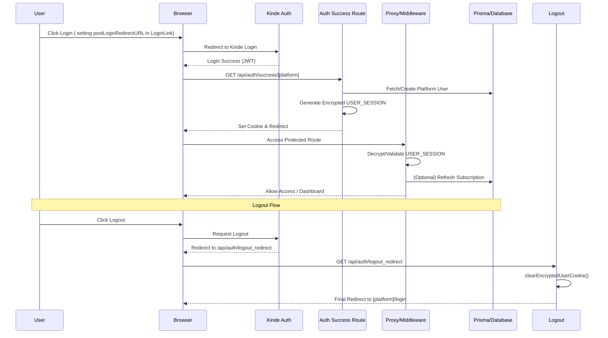
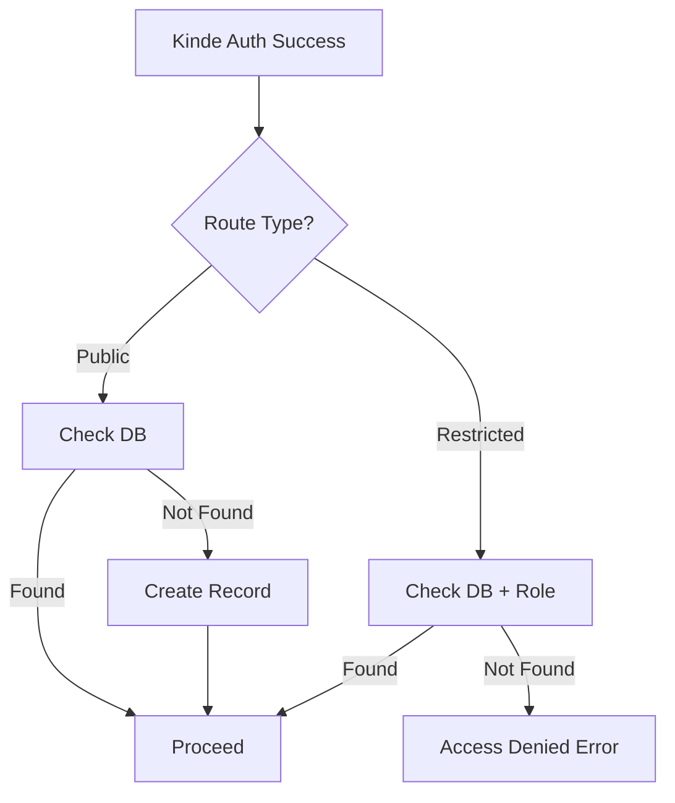

# Authentication & Authorization Technical Guide

This document deep-dives into the technical implementation of the authentication and authorization system in Twonodes.

## 1. High-Level Architecture

Twonodes uses a hybrid authentication model combining **Kinde Auth** for identity management and a **Custom Encrypted Session** for platform-specific context and authorization.



### 1.1 Post-Login Redirection Flow

While Kinde has a default redirection path configured in the management dashboard and the `.env` file (`KINDE_POST_LOGIN_REDIRECT_URL`), Twonodes overrides this dynamically per platform to ensure users hit the correct session initialization logic.

Each platform's login page uses the Kinde `LoginLink` component with a specific `postLoginRedirectURL` prop. This routes the user to a platform-specific success handler (e.g., `/api/auth/success/reva`) rather than a generic one.

**Common Redirection Targets:**
- **Reva**: `/api/auth/success/reva` (or `/reva-restricted`)
- **Surfboard**: `/api/auth/success/surfboard` (or `/surf-mda`, `/surf-restricted`)
- **GBC**: `/api/auth/success/gbc` (or `/gbc-restricted`)

If no specific URL is provided to the `LoginLink`, the system falls back to the default defined in the Kinde Dashboard and the `KINDE_POST_LOGIN_REDIRECT_URL` environment variable.

### 1.2 Post-Logout Redirection Flow

Logout handling is centralized through the `/api/auth/logout_redirect` route. This ensures that users are not just "logged out" but are also returned to their platform's specific landing page.

1.  **Global Configuration**: Both the Kinde Dashboard and the `.env` file (`KINDE_POST_LOGOUT_REDIRECT_URL`) must point to `/api/auth/logout_redirect`.
2.  **Context-Aware Redirection**: The handler identifies the user's platform and role *from the session* before destroying it.
3.  **Redirection Logic**:
    - **Reva**: Redirects to `/reva-restricted/login` for admins/superadmins, or `/reva/login` for regular users.
    - **Surfboard**: 
        - Admins/Superadmins -> `/surf-restricted/login`
        - MDA Roles (Accounts, Charting, etc.) -> `/surf-mda/login`
        - Regular Users -> `/surfboard/login`
    - **GBC**: Redirects to `/gbc/restricted-login` for admins, or `/gbc/login` for regular users.
4.  **Session Cleanup**: The handler explicitly calls `clearEncryptedUserCookie` on the response object to purge the custom `USER_SESSION` cookie from the browser.
5.  **Fallback**: If no session data is found during logout, the system defaults to the site root `/`.


## 2. Registration Workflow

Twonodes employs two distinct registration strategies depending on the target platform:

### A. Self-Service (Auto-Registration)
Used for public-facing platforms like **Reva**, **Surfboard**, and **GBC**.
- **Logic**: The system checks if a record exists for the Kinde `userId` or `email`. 
- **Action**: If no record exists, it automatically creates one (e.g., in the `SurfboardUser` table) and assigns a default `USER` role.
- **Outcome**: Seamless onboarding for new users.

### B. Delegated (Admin-Registration)
Used for administrative and restricted portals like **Surf-MDA** and **Reva Restricted**.
- **Logic**: The system searches for an existing record in the database (`SurfboardUser` or `RevaUser`) that specifically has an appropriate role (e.g., `ACCOUNTS`, `ADMIN`).
- **Action**: If no record is found, it **rejects the login attempt** and redirects the user to an error page.
- **Requirement**: Users must be pre-registered by an existing Administrator through the respective admin dashboard.



## 3. Platform Isolation & Privilege

An essential feature of the system is the isolation between platforms and even within different "sides" of the same service.

### Privilege-Based Access
Authentication via Kinde is the first step, but it does not grant automatic access to any platform. A user must:
1.  **Be Registered**: Have a corresponding record in the specific platform's database table (e.g., `SurfboardUser`, `RevaUser`).
2.  **Have Privileges**: Possess the required role for that platform.

### Example: Surfboard Partitioning
- **Ordinary User**: Can login to `/surfboard/dashboard` but **cannot** access `/surf-mda/dashboard` or `/surf-restricted/dashboard`.
- **Restrictive Access**: Access to `surf-mda`, `reva-restricted`, etc., requires the user to be pre-registered by an admin.
- **MDA User**: (e.g., Accounts, Charting) Has access to the MDA portal but cannot log into the standard Surfboard user dashboard unless they are also registered there.
- **Admin/SuperAdmin**: Has high-level privileges often restricted to specific administrative paths.

This isolation is enforced at the `proxy.ts` layer by checking both the `userData.platform` and the `userData.role`.

## 4. Session Management (Custom USER_SESSION)

### The `USER_SESSION` Cookie
While Kinde manages the primary identity session, we maintain a custom `USER_SESSION` cookie to store platform-specific metadata. This avoids expensive database joins and cross-platform checks on every request.

- **Location**: `utils/encryptedCookies.ts`
- **Encryption**: Uses `jose` with `A256GCM` (AES-256-GCM).
- **Cookie Name**: `USER_SESSION`
- **Security**: `httpOnly: true`, `secure: true` (in production), `sameSite: strict`.

interface PlatformSession {
  role: RevaRole | SurfboardRole | GBCRole;
  subscription?: {
    status: "active" | "cancelled" | "expired" | "past_due";
    interval: "monthly" | "quarterly" | "annually";
    expiresAt?: number | string | Date | null;
    subCode?: string;
    planCode?: string;
    emailToken?: string;
  };
}

export interface EncryptedUserData {
  platforms: Partial<Record<Platform, PlatformSession>>;
  userId: string;
  email: string;
  firstName: string;
  lastName: string;
  kindeId: string;
  sessionId: string;
  lastActivity: number;
  picture?: string | null;
}
```

### Multi-Platform Simultaneous Login
The system supports concurrent login to multiple platforms (e.g., Reva, Surfboard, and GBC). When a user logs into a new platform, the `setEncryptedUserCookie` function merges the new platform session into the existing `USER_SESSION` cookie instead of overwriting it.

### Session Refresh Logic
The `proxy.ts` layer automatically refreshes the `lastActivity` timestamp and updates subscription data in the cookie for all active platform sessions, ensuring the session stays alive during active use across the entire ecosystem.

## 5. The Proxy Layer (`proxy.ts`)

The `proxy.ts` file acts as a dynamic middleware wrapper. It combines Kinde's `withAuth` with our custom session validation.

### Core Responsibilities:
1.  **Public vs. Protected**: Defines `protectedRoutes` and `publicRoutes` patterns.
2.  **Dynamic Login Redirection**: Based on the pathname, it determines which landing page to redirect unauthenticated users to (e.g., `/surfboard/login` vs `/gbc/login`).
3.  **Role Validation**: It extracts the `userData` from the encrypted cookie and calls permission helpers to verify access.
4.  **Subscription Guard**: Specifically for Surfboard, it checks if the user has an active subscription before allowing access to certain dashboard features.

## 6. Authorization & Permissions (`permissions.ts`)

Authorization is handled through a set of granular helper functions in `permissions.ts`. This file defines roles for each platform:

- **REVA**: `USER`, `ADMIN`, `SUPERADMIN`
- **Surfboard**: `USER`, `ADMIN`, `SUPERADMIN`, plus MDA-specific roles like `ACCOUNTS`, `RECORDS_I`, etc.
- **GBC**: `USER`, `ADMIN`, `SUPERADMIN`

### Usage in Proxy:
```typescript
if (pathname.startsWith("/reva-restricted/dashboard")) {
  hasAccess = canAccessRevaAdminPanel(userData.role);
}
```

## 7. Environment Variables

The authentication system relies on the following environment variables in `.env`:

### Kinde Configuration
- `KINDE_CLIENT_ID`: The client ID for the Kinde application.
- `KINDE_CLIENT_SECRET`: The client secret for the Kinde application.
- `KINDE_ISSUER_URL`: The base URL of your Kinde business (e.g., `https://twonodetechnologies.kinde.com`).
- `KINDE_SITE_URL`: The base URL of your application (usually `http://localhost:3000` in dev).
- `KINDE_POST_LOGIN_REDIRECT_URL`: The route Kinde redirects to after a successful login (typically `/api/auth/success`).
- `KINDE_POST_LOGOUT_REDIRECT_URL`: The route Kinde redirects to after logout.

### Custom Session Configuration
- `COOKIE_ENCRYPTION_KEY`: **CRITICAL**. A 32-byte hex string (64 characters) used for AES-256-GCM encryption of the `USER_SESSION` cookie.
- `JWT_SECRET`: Used for legacy JWT operations or other non-session tokens.
- `SALT_ROUNDS`: Used for password hashing if local accounts are used.

### Base URLs
- `BASE_URL`: The internal base URL for server-side redirects.
- `NEXT_PUBLIC_BASE_URL`: The public-facing base URL for client-side use.

## 8. Security Best Practices

> [!CAUTION]
> **Keep your keys secret**: Never commit the `.env` file to version control. The `COOKIE_ENCRYPTION_KEY` and `KINDE_CLIENT_SECRET` are extremely sensitive. Exposure could allow attackers to forge session cookies and gain full access to any account.

- **Rotating Keys**: If the `COOKIE_ENCRYPTION_KEY` is ever compromised, it must be rotated immediately. Note that rotating the key will invalidate all active user sessions.
- **Production Settings**: Ensure `NODE_ENV=production` is set in your production environment so that cookies are marked as `secure`.

## 9. Architectural Evolution (Roadmap)

### Multi-Platform Simultaneous Login
The system has been transitioned to support a **mapped session model** (`platforms: Record<Platform, Session>`).
- **Benefit**: Users can stay logged into multiple platforms (e.g., REVA and Surfboard) simultaneously.
- **Implementation**: The `middleware.ts` (proxy) dynamically detects the platform from the URL and validates the specific session for that platform without disturbing others.
- **Frontend Impact**: Components can now check for presence in multiple platforms to provide cross-platform shortcuts and status indicators.
