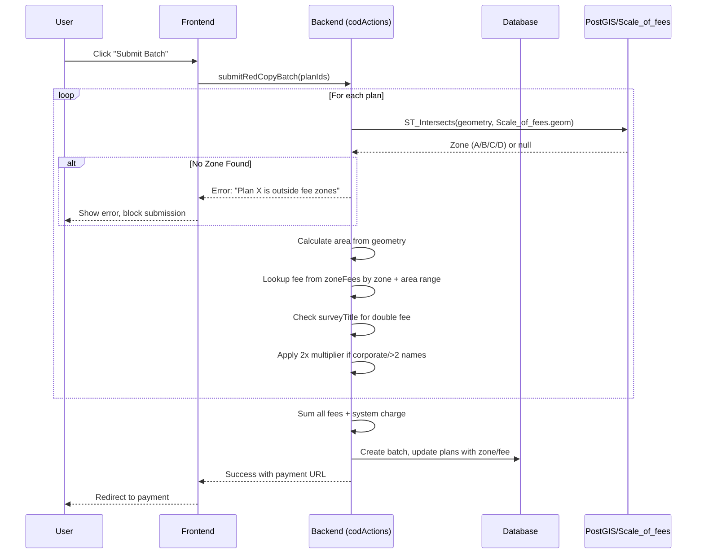
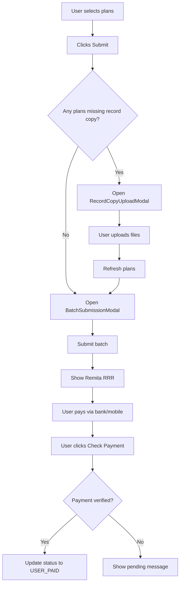
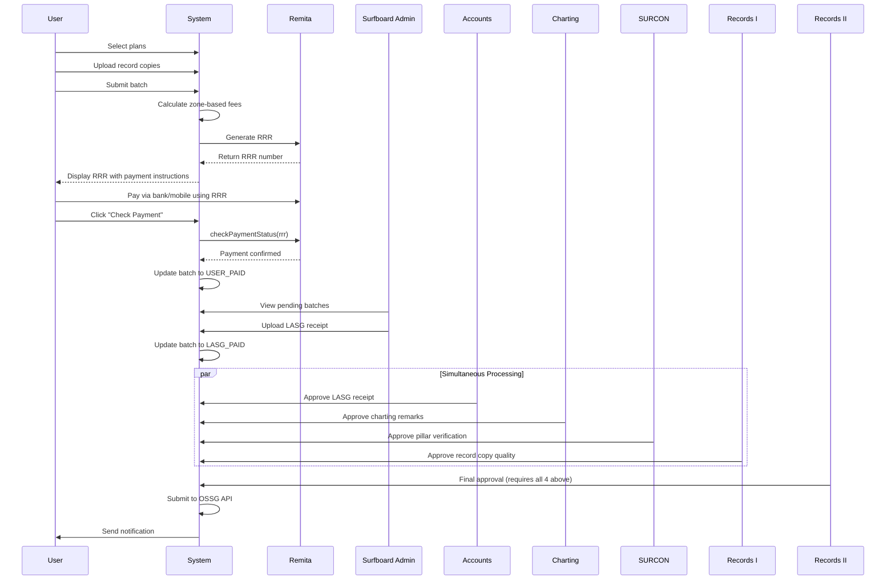

# Certificate of Deposit Implementation Walkthrough

## Implementation Complete! 🎉

All missing integrations for the Certificate of Deposit workflow have been implemented, including the new zone-based fee system.

---

## Table of Contents

1. [Zone-Based Fee System (New)](#zone-based-fee-system)
2. [Task Checklist](#task-checklist)
3. [User Plan Selection](#user-plan-selection-with-record-copy-upload)
4. [Payment Integration](#payment-integration)
5. [Admin Dashboards](#mda-admin-dashboards)
6. [Complete Workflow](#complete-workflow)

---

# Zone-Based Fee System

## Overview

Replaced the LGA-based fee calculation system with a **Zone-based system** where fees are determined by:

1. **Zone** (lagosZoneA, lagosZoneB, lagosZoneC, lagosZoneD) - determined via spatial intersection with `Scale_of_fees` table
2. **Area Range** - lookup fixed fee from COD_FEES table based on parcel area

### Key Business Rules

- **Zone Determination**: Intersect plan geometry with `Scale_of_fees(id, geom, Name, Zone)` dataset
- **Fee Lookup**: Use Zone + Area Range → Fixed Fee (not per-sqm rate)
- **Double Fee**: Apply 2x multiplier if:
  - Survey title contains > 2 names (detected via newline `\n` separation + AI detection), OR
  - `ethnicity` field indicates "corporate" ownership
- **No Zone = Block Submission**: If geometry doesn't intersect any zone, show error and prevent submission

> [!NOTE]
> **Scale_of_fees Table**: Zone column values are `lagosZoneA`, `lagosZoneB`, `lagosZoneC`, `lagosZoneD`.

> [!WARNING]
> **Breaking Change**: This completely removes the LGA-based fee system. Existing settings with `lgaFees` will be migrated to `zoneFees`.

---

## Zone Fee Changes Made

### 1. Fee Data Structure (`CoDFees.ts`)

- Updated with `ZoneFeeRow` interface and `lagosZoneA/B/C/D` naming convention
- Contains 26 fee tiers based on area ranges from 0-466+ hectares

```typescript
export interface ZoneFeeRow {
  range: string;
  start: number; // Area start in SQM
  end: number; // Area end in SQM
  lagosZoneA: number; // Fee in Naira
  lagosZoneB: number;
  lagosZoneC: number;
  lagosZoneD: number;
}

export const COD_FEES: ZoneFeeRow[] = [
  // 26 fee tiers...
];
```

### 2. Database Schema (`schema.prisma`)

- Added `Scale_of_fees` model for spatial zone data
- Added fields to `SurfboardPlan`: `zone`, `codFee`, `isDoubleFee`, `ethnicity`

```prisma
// Add to SurfboardPlan model
zone           String?   // Detected zone from Scale_of_fees (e.g., "lagosZoneA", "lagosZoneB")
codFee         Float?    // Calculated CoD fee for this plan
isDoubleFee    Boolean   @default(false)  // True if corporate or >2 names
ethnicity      String?   // "individual" or "corporate" - used for double fee detection
```

### 3. Backend Fee Calculation (`codActions.ts`)

**New Functions:**

- `getZoneFromGeometry()` - Spatial intersection with Scale_of_fees table
- `shouldChargeDoubleFee()` - Detects corporate ownership or >2 names in survey title
- `calculatePlanFeeByZone()` - Looks up fee by zone + area range

**Updated:**

- `submitRedCopyBatch()` - Now uses zone-based fee calculation, blocks plans outside Lagos zones, stores zone/fee data on each plan

**Removed:**

- `getLGAFees()`, `calculatePlanFee()`, `calculateMultiplePlanFee()`

### 4. Settings Actions (`settingsActions.ts`)

- Replaced `lgaFees` with `zoneFees` in `SurfboardSettingsData` interface
- Updated `DEFAULT_SETTINGS` to use `COD_FEES` array
- Added `getZoneFees()` and `getSystemChargePercent()` exported functions
- Implemented CSV parsing and validation logic in `handleCSVUpload`

### 5. Settings Page UI (`settings/page.tsx`)

- Updated MDA Settings tab to display zone fee table
- Added **CSV Upload** functionality for bulk fee updates
- Added **CSV Format Help** modal
- Added **CSV Preview** modal with validation
- Editable fee amounts per zone (A, B, C, D) for each area range
- Removed LGA-specific UI (Add LGA, CSV upload, etc.)
- Updated Settings History modal for zone fees

---

## Double Fee Logic

Survey plans are charged 2x the base fee if:

1. `ethnicity` field is "corporate"
2. Survey title contains >2 names (detected via newline splitting)
3. Survey title contains corporate keywords (Ltd, Inc, PLC, Company, etc.)
4. Survey title has >2 names separated by "and" or "&"

---

## CSV Format Specification

The CSV file should support the following columns (case-insensitive headers):

- `Range` (string, e.g., "0 - 1000")
- `Start` (number, start area in sqm)
- `End` (number, end area in sqm)
- `Lagos Zone A` / `Zone A` (number, fee)
- `Lagos Zone B` / `Zone B` (number, fee)
- `Lagos Zone C` / `Zone C` (number, fee)
- `Lagos Zone D` / `Zone D` (number, fee)

**Example:**

```csv
Range,Start,End,Zone A,Zone B,Zone C,Zone D
"0 - 1000",0,1000,5000,4000,3000,2000
```

---

## Zone Fee Flow Diagram



---

# Task Checklist

## Planning

- [x] Create implementation plan
- [x] Update COD_FEES with lagosZoneA/B/C/D naming
- [x] Add ZoneFeeRow TypeScript interface

## Database Changes

- [x] Update `SurfboardSettings` to store zone-based fees instead of LGA fees
- [x] Add `zone`, `codFee`, `isDoubleFee`, `ethnicity` fields to `SurfboardPlan` model
- [x] Add `Scale_of_fees` model to schema
- [x] Run Prisma generate

## Backend - Fee Calculation Logic

- [x] Create `getZoneFromGeometry()` function - spatial intersection with Scale_of_fees
- [x] Create `shouldChargeDoubleFee()` - corporate/multiple-name detection
- [x] Create `calculatePlanFeeByZone()` - use zone + area range lookup
- [x] Update `submitRedCopyBatch()` - implement new zone-based flow
- [x] Remove LGA fee functions (`getLGAFees`, `calculatePlanFee`, `calculateMultiplePlanFee`)

## Backend - Settings Actions

- [x] Update `settingsActions.ts` - replace lgaFees with zoneFees
- [x] Add `getZoneFees()` and `getSystemChargePercent()` exported functions
- [x] Update DEFAULT_SETTINGS to use COD_FEES

## Frontend - Settings Page

- [x] Update SettingsData interface to use zoneFees
- [x] Update settings page UI for zone fee management
- [x] Remove LGA fee management UI
- [x] Add zone fee table editor (range, lagosZoneA/B/C/D)
- [x] Implement CSV upload for Zone Fees
- [x] Update Settings History modal for zone fees

## Testing & Verification

- [x] TypeScript compilation passes
- [ ] Test zone determination with sample geometries
- [ ] Test fee calculation with corporate/multiple names
- [ ] Test batch submission flow
- [ ] Test settings management UI

---

# User Plan Selection with Record Copy Upload

#### [AllPlans.tsx](<file:///home/roji/UBUNTU/RTG_CODE/NextJS/twonodes/app/(projects)/(surfboard)/surfboard/dashboard/plans/AllPlans.tsx>)

**Changes:**

- Imported RecordCopyUploadModal component
- Added `uploadModalOpen` state for controlling the upload modal
- Modified handleBatchSubmit to check for missing record copies before submission
- Added handleUploadComplete callback for when uploads finish
- Integrated the upload modal into the component render

**Flow:**



#### Record Copy Status Indicators

Added visual indicators in both **list view** and **grid view** showing:

- ✅ **Green checkmark** - Record copy uploaded
- ⏳ **Amber clock** - Record copy not uploaded

---

# Payment Integration (Remita)

> [!NOTE]
> Payment has been migrated from Paystack to **Remita RRR** for Certificate of Deposit.

#### [codActions.ts](<file:///home/roji/UBUNTU/RTG_CODE/NextJS/twonodes/app/(projects)/(surfboard)/actions/codActions.ts>)

**Changes to submitRedCopyBatch:**

**What it does:**

1. Calculates zone-based fees for all plans
2. Creates the batch record
3. Calls `generateRRR()` from `utils/remita.ts`
4. Returns `rrr`, `paymentUrl`, and `totalAmount`

#### [utils/remita.ts](<file:///home/roji/UBUNTU/RTG_CODE/NextJS/twonodes/app/(projects)/(surfboard)/utils/remita.ts>)

**New Remita utility functions:**

- `generateRRR()` - Generate Remita Retrieval Reference for payment
- `checkPaymentStatus()` - Check if RRR has been paid
- `getRemitaPaymentUrl()` - Get online payment URL for RRR

#### [CertificateBatchSelection.tsx](<file:///home/roji/UBUNTU/RTG_CODE/NextJS/twonodes/app/(projects)/(surfboard)/components/CertificateBatchSelection.tsx>)

**Updated BatchSubmissionModal:**

- Displays RRR number with copy button
- Shows payment amount and instructions
- "Pay Online via Remita" button
- "Check Payment Status" button for verification

#### Environment Variables Required

```bash
REMITA_MERCHANT_ID=xxx
REMITA_API_KEY=xxx
REMITA_SERVICE_TYPE_ID=xxx
REMITA_BASE_URL=https://remitademo.net  # or https://login.remita.net for production
```

---

# Surfboard Admin - Batch Management

#### [Batch Management Page](<file:///home/roji/UBUNTU/RTG_CODE/NextJS/twonodes/app/(projects)/(surfboard)/surf-restricted/dashboard/cod/batches/page.tsx>)

**Features:**

- Lists batches with status `USER_PAID`
- Shows batch statistics (count, plans, total amount)
- Upload LASG receipt with file validation
- Updates batch status to `LASG_PAID`

#### [Batches API Route](file:///home/roji/UBUNTU/RTG_CODE/NextJS/twonodes/app/api/surfboard/batches/route.ts)

**New API endpoint** for fetching batches:

- Requires ADMIN/SUPERADMIN role
- Optional status filter via query param
- Returns batch details with submitter info

---

# MDA Admin Dashboards

#### [SURCON Admin](<file:///home/roji/UBUNTU/RTG_CODE/NextJS/twonodes/app/(projects)/(surfboard)/surf-restricted/dashboard/cod/surcon/page.tsx>)

**Purpose:** Verify pillar numbers match SURCON database

**Features:**

- Calls getSurconPlans() to fetch pending plans
- Displays pillar coordinates with copy button
- Approve/Query with comment
- Shows Accounts and Charting approval status

---

#### [Records I Admin](<file:///home/roji/UBUNTU/RTG_CODE/NextJS/twonodes/app/(projects)/(surfboard)/surf-restricted/dashboard/cod/records-i/page.tsx>)

**Purpose:** Review uploaded record copies for quality

**Features:**

- Calls getRecordsIPlans() to fetch pending plans
- Image preview modal for record copies
- Open in new tab for PDFs
- Approve/Query functionality
- Shows all other approval statuses

---

#### [Records II Admin](<file:///home/roji/UBUNTU/RTG_CODE/NextJS/twonodes/app/(projects)/(surfboard)/surf-restricted/dashboard/cod/records-ii/page.tsx>)

**Purpose:** Final approval before OSSG submission

**Features:**

- Only shows plans with ALL 4 other approvals complete
- Batch progress indicator
- Final charting remarks display
- Physical copy verification prompt
- Submitter information
- Lodge/Query functionality

---

## Dashboard URLs

| Dashboard        | URL                                         | Role       |
| ---------------- | ------------------------------------------- | ---------- |
| All Plans        | `/surfboard/dashboard/plans`                | User       |
| Batch Management | `/surf-restricted/dashboard/cod/batches`    | Admin      |
| Accounts Admin   | `/surf-restricted/dashboard/cod/accounts`   | Accounts   |
| Charting Admin   | `/surf-restricted/dashboard/cod/charting`   | Charting   |
| SURCON Admin     | `/surf-restricted/dashboard/cod/surcon`     | SURCON     |
| Records I Admin  | `/surf-restricted/dashboard/cod/records-i`  | Records I  |
| Records II Admin | `/surf-restricted/dashboard/cod/records-ii` | Records II |
| **Settings**     | `/surf-restricted/dashboard/settings`       | SuperAdmin |

---

# Complete Workflow



---

## Files Modified

### Zone Fee System

- `app/(projects)/(surfboard)/actions/codActions.ts`
- `app/(projects)/(surfboard)/actions/settingsActions.ts`
- `app/(projects)/(surfboard)/surf-restricted/dashboard/settings/page.tsx`
- `app/(projects)/(surfboard)/utils/CoDFees.ts`
- `prisma/schema.prisma`

### Remita Payment Migration

- `app/(projects)/(surfboard)/utils/remita.ts` **(NEW)**
- `app/(projects)/(surfboard)/actions/codActions.ts`
- `app/(projects)/(surfboard)/components/CertificateBatchSelection.tsx`

---

## Verification Plan

### Automated Tests

1. **Zone Detection**: Test `getZoneFromGeometry()` with sample coordinates
   - Inside Zone A → returns "lagosZoneA"
   - Inside Zone D → returns "lagosZoneD"
   - Outside Lagos → returns null

2. **Fee Calculation**: Test `calculatePlanFeeByZone()`
   - 500 sqm in Zone A → ₦11,500
   - 500 sqm in Zone D → ₦1,750
   - 1,500 sqm in Zone B → ₦11,500 (range 1401-2100)

3. **Double Fee Detection**:
   - "Mr. John Doe" → single fee
   - "John Doe & Mary Doe & Peter Doe" → double fee (>2 names)
   - "ABC Corporation Limited" → double fee (corporate)

### Manual Verification

1. Submit a batch with plans in different zones
2. Verify correct fees are calculated
3. Test settings page zone fee editor
4. Test batch rejection when plan has no zone

---

## What's Next?

> [!TIP]
>
> ### Remaining Optional Enhancements
>
> 1. **Email Notifications** - Send emails at key workflow stages
> 2. **Lock Mechanism UI** - Integrate lock/unlock in MDA dashboards
> 3. **OSSG API Integration** - Actual submission to Lagos State
> 4. **Query/Resubmission Flow** - UI for users to edit queried plans
> 5. **Runtime Testing** - Test zone determination with sample geometries
