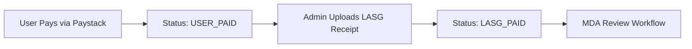
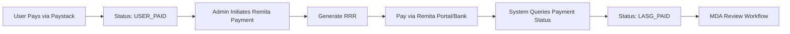

# Remita Payment Integration for MDA Payments

Integrate Remita payment gateway to allow Surfboard Admin to pay LASG fees directly into the MDA Remita account, replacing the manual receipt upload flow.

## User Review Required

> [!IMPORTANT] > **MDA Biller Product ID Required**
> To generate an RRR for LASG, we need the specific `billPaymentProductId` for the MDA account. Do you have this value, or should we add a settings field for admin to configure it?

> [!WARNING] > **Credential Requirements**
> Remita requires `PUBLIC_KEY` and `SECRET_KEY` for authentication. These need to be added to your environment variables before testing.

## Current Payment Flow



## Proposed Flow with Remita



---

## Proposed Changes

### Remita Utility Module

#### [NEW] [remita.ts](<file:///home/rojitech/Desktop/CODEC/NextJS/twonodes/app/(projects)/(surfboard)/utils/remita.ts>)

Create a Remita API client similar to the existing `paystack.ts`:

```typescript
// Key functions to implement:
-getRemitaToken() - // Authenticate and get Bearer token
  generateRRR() - // Initiate bill payment, returns RRR
  getRRRDetails() - // Lookup RRR details
  queryTransactionStatus(); // Check payment status
```

**API Endpoints:**

| Environment | Auth URL                                                | Biller URL                                             |
| ----------- | ------------------------------------------------------- | ------------------------------------------------------ |
| Demo        | `https://remitademo.net/remita/exapp/api/v1/send/api`   | `https://remitademo.net/.../bgatesvc/v3/billpayment`   |
| Live        | `https://login.remita.net/remita/exapp/api/v1/send/api` | `https://login.remita.net/.../bgatesvc/v3/billpayment` |

---

### Database Schema

#### [MODIFY] [schema.prisma](file:///home/rojitech/Desktop/CODEC/NextJS/twonodes/prisma/schema.prisma)

Add Remita-specific fields to `CertificateOfDepositBatch`:

```prisma
model CertificateOfDepositBatch {
  // Existing fields...

  // New Remita fields
  remitaRRR             String?   // Generated RRR
  remitaTransactionRef  String?   // Local transaction reference
  remitaPaymentStatus   String?   // PENDING, SUCCESSFUL, FAILED
  remitaPaymentDate     DateTime? // When Remita payment confirmed
  remitaInitiatedBy     String?   // Admin who initiated payment
  remitaInitiatedAt     DateTime?
}
```

---

### Backend Actions

#### [MODIFY] [codActions.ts](<file:///home/rojitech/Desktop/CODEC/NextJS/twonodes/app/(projects)/(surfboard)/actions/codActions.ts>)

Add new server actions:

1. **`generateRemitaRRR(batchId: string)`**

   - Authenticates with Remita
   - Calls `/biller/transaction/initiate`
   - Saves RRR to batch record
   - Returns RRR for admin to use

2. **`verifyRemitaPayment(batchId: string)`**

   - Calls `/biller/transaction/query/{transactionRef}`
   - Updates batch status to `LASG_PAID` if successful
   - Triggers notifications to MDA admins

3. **Update `uploadLASGReceipt()`**
   - Keep as fallback option
   - Add option to switch between manual receipt and Remita

---

### Admin UI

#### [MODIFY] [page.tsx](<file:///home/rojitech/Desktop/CODEC/NextJS/twonodes/app/(projects)/(surfboard)/surf-restricted/dashboard/cod/batches/page.tsx>)

Update the batch management page:

- Add "Pay via Remita" button alongside "Upload Receipt"
- Display generated RRR with copy button
- Add "Verify Payment" button to check Remita status
- Show Remita payment status badge

**UI Flow:**

1. Admin clicks "Pay via Remita"
2. System generates RRR and displays it
3. Admin pays via Remita portal or bank
4. Admin clicks "Verify Payment"
5. System confirms payment and updates status

---

### Environment Variables

#### [NEW] `.env` additions

```env
# Remita Configuration
REMITA_PUBLIC_KEY=your_public_key
REMITA_SECRET_KEY=your_secret_key
REMITA_BILLER_PRODUCT_ID=mda_product_id
REMITA_ENVIRONMENT=demo  # or "live"
```

---

## Verification Plan

### Manual Verification

1. **Generate RRR Test**

   - Navigate to `/surf-restricted/dashboard/cod/batches`
   - Find a batch with status `USER_PAID`
   - Click "Pay via Remita"
   - Verify RRR is generated and displayed
   - Copy RRR and verify format matches expected pattern

2. **Payment Verification Test**
   - Use the generated RRR to make a test payment on Remita demo
   - Return to the batches page
   - Click "Verify Payment"
   - Confirm status changes to `LASG_PAID`
   - Verify MDA admins receive notification

### Questions for User

1. Do you have the **Remita credentials** (PUBLIC_KEY, SECRET_KEY) for either demo or production?
2. Do you know the **billPaymentProductId** for the specific MDA account you're paying into?
3. Should we keep the manual receipt upload as a **fallback option**?
4. Do you want the admin to be able to **see the payment link** to pay directly, or should they pay separately via bank?
