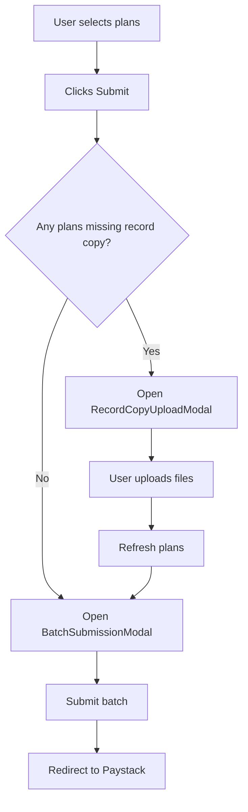
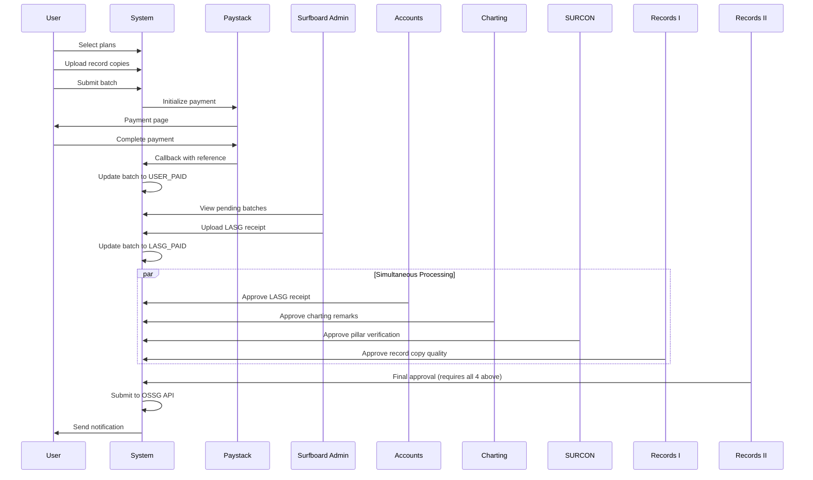

# Certificate of Deposit Implementation Walkthrough

## Implementation Complete! 🎉

All missing integrations for the Certificate of Deposit workflow have been implemented.

---

## Changes Made

### 1. User Plan Selection with Record Copy Upload

#### [AllPlans.tsx](<file:///home/rojitech/Desktop/CODEC/NextJS/twonodes/app/(projects)/(surfboard)/surfboard/dashboard/plans/AllPlans.tsx>)

**Changes:**

- Imported `RecordCopyUploadModal` component
- Added `uploadModalOpen` state for controlling the upload modal
- Modified `handleBatchSubmit` to check for missing record copies before submission
- Added `handleUploadComplete` callback for when uploads finish
- Integrated the upload modal into the component render

**Flow:**

#### Record Copy Status Indicators

Added visual indicators in both **list view** and **grid view** showing:

- ✅ **Green checkmark** - Record copy uploaded
- ⏳ **Amber clock** - Record copy not uploaded

---

### 2. Payment Integration

#### [codActions.ts](<file:///home/rojitech/Desktop/CODEC/NextJS/twonodes/app/(projects)/(surfboard)/actions/codActions.ts>)

**Changes to `submitRedCopyBatch`:**

render_diffs(file:///home/rojitech/Desktop/CODEC/NextJS/twonodes/app/(projects)/(surfboard)/actions/codActions.ts)

**What it does:**

1. Gets user email for Paystack
2. Generates unique reference: `COD_{batchCode}_{timestamp}`
3. Calls `paystack.transactions.initialize()`
4. Returns `paymentUrl` for redirect

#### [Payment Callback Page](<file:///home/rojitech/Desktop/CODEC/NextJS/twonodes/app/(projects)/(surfboard)/surfboard/dashboard/payment/callback/page.tsx>)

**New file** that handles Paystack callback:

- Extracts `reference` from URL params
- Calls `verifyBatchPayment()` action
- Shows success/error states
- Provides link back to dashboard

---

### 3. Surfboard Admin - Batch Management

#### [Batch Management Page](<file:///home/rojitech/Desktop/CODEC/NextJS/twonodes/app/(projects)/(surfboard)/surf-restricted/dashboard/cod/batches/page.tsx>)

**Features:**

- Lists batches with status `USER_PAID`
- Shows batch statistics (count, plans, total amount)
- Upload LASG receipt with file validation
- Updates batch status to `LASG_PAID`

#### [Batches API Route](file:///home/rojitech/Desktop/CODEC/NextJS/twonodes/app/api/surfboard/batches/route.ts)

**New API endpoint** for fetching batches:

- Requires ADMIN/SUPERADMIN role
- Optional status filter via query param
- Returns batch details with submitter info

---

### 4. MDA Admin Dashboards

#### [SURCON Admin](<file:///home/rojitech/Desktop/CODEC/NextJS/twonodes/app/(projects)/(surfboard)/surf-restricted/dashboard/cod/surcon/page.tsx>)

**Purpose:** Verify pillar numbers match SURCON database

**Features:**

- Calls `getSurconPlans()` to fetch pending plans
- Displays pillar coordinates with copy button
- Approve/Query with comment
- Shows Accounts and Charting approval status

---

#### [Records I Admin](<file:///home/rojitech/Desktop/CODEC/NextJS/twonodes/app/(projects)/(surfboard)/surf-restricted/dashboard/cod/records-i/page.tsx>)

**Purpose:** Review uploaded record copies for quality

**Features:**

- Calls `getRecordsIPlans()` to fetch pending plans
- Image preview modal for record copies
- Open in new tab for PDFs
- Approve/Query functionality
- Shows all other approval statuses

---

#### [Records II Admin](<file:///home/rojitech/Desktop/CODEC/NextJS/twonodes/app/(projects)/(surfboard)/surf-restricted/dashboard/cod/records-ii/page.tsx>)

**Purpose:** Final approval before OSSG submission

**Features:**

- Only shows plans with ALL 4 other approvals complete
- Batch progress indicator
- Final charting remarks display
- Physical copy verification prompt
- Submitter information
- Lodge/Query functionality

---

## Dashboard URLs

| Dashboard        | URL                                         | Role       |
| ---------------- | ------------------------------------------- | ---------- |
| All Plans        | `/surfboard/dashboard/plans`                | User       |
| Batch Management | `/surf-restricted/dashboard/cod/batches`    | Admin      |
| Accounts Admin   | `/surf-restricted/dashboard/cod/accounts`   | Accounts   |
| Charting Admin   | `/surf-restricted/dashboard/cod/charting`   | Charting   |
| SURCON Admin     | `/surf-restricted/dashboard/cod/surcon`     | SURCON     |
| Records I Admin  | `/surf-restricted/dashboard/cod/records-i`  | Records I  |
| Records II Admin | `/surf-restricted/dashboard/cod/records-ii` | Records II |

---

## Complete Workflow

---

## What's Next?

> [!TIP]
>
> ### Remaining Optional Enhancements
>
> 1. **Email Notifications** - Send emails at key workflow stages
> 2. **Lock Mechanism UI** - Integrate lock/unlock in MDA dashboards
> 3. **OSSG API Integration** - Actual submission to Lagos State
> 4. **Query/Resubmission Flow** - UI for users to edit queried plans
