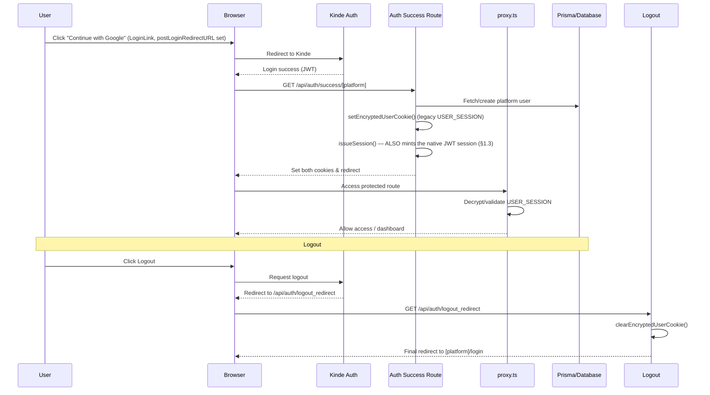

# Authentication & Authorization Technical Guide

This document deep-dives into the technical implementation of authentication and authorization in Twonodes.

> **Two parallel auth systems are live at once.** A native, hand-rolled email+password/JWT system (built during the 2026-08 architecture rebuild, modeled on sibling project proplity's patterns) is the primary path today. Kinde OAuth (Google, etc.) is **not retired** — it still runs as a full, independent auth system for its own login buttons, and a successful Kinde login _also_ mints a native session alongside its own legacy cookie, so downstream code only has to check one thing. See §9 for exactly why both still exist and what depends on each.

---

## 1. Native Email+Password Auth (primary path)

Built in `docs/development-history/phases/phase-1-foundations.md` (Steps 4-6), audited post-rebuild in that same document's "Post-Phase-5 auth audit" section. This is what every registration/login form in the app (`NativeAuthCard`) calls.

### 1.1 Routes — `app/api/v1/auth/*`

| Route                                 | Method | Auth                         | Purpose                                                                                                                                                                                                                                                  |
| ------------------------------------- | ------ | ---------------------------- | -------------------------------------------------------------------------------------------------------------------------------------------------------------------------------------------------------------------------------------------------------- |
| `/api/v1/auth/register/send-otp`      | POST   | public, CSRF-checked         | **Step 1 of OTP/link-first registration** (see 1.7): stores a `PendingRegistration` and emails a 6-digit code or a link, per the platform's `method`.                                                                                                    |
| `/api/v1/auth/register/resend-otp`    | POST   | public, CSRF-checked         | Re-issues the secret for a pending signup (new secret, attempt counter reset).                                                                                                                                                                           |
| `/api/v1/auth/register`               | POST   | public, CSRF-checked         | **Final step of OTP/link-first registration**: takes `{pendingRegistrationId, code, password}`, verifies, and creates the already-verified `{Reva,Surfboard,GBC}User` row. Never accepts an email or role from the client.                               |
| `/api/v1/auth/login`                  | POST   | public, CSRF-checked         | `bcrypt.compare` against `passwordHash`; issues a session on success (see 1.3).                                                                                                                                                                          |
| `/api/v1/auth/refresh`                | POST   | refresh cookie               | Rotates the refresh token; see 1.4 for the reuse-detection behavior. Re-reads the user, so verification/settings changes reach the JWT within one refresh.                                                                                               |
| `/api/v1/auth/logout`                 | POST   | session                      | Revokes the current refresh token, clears cookies.                                                                                                                                                                                                       |
| `/api/v1/auth/me`                     | GET    | session                      | Caller's identity/role for the given platform, plus `emailVerified`, `emailVerifiedVia`, `mustVerifyNow`, `verificationMethod`, `verificationGraceEndsAt` (see 1.8). Not wrapped in `withAuth`, so it stays reachable while gated.                       |
| `/api/v1/auth/change-password`        | POST   | session                      | Shared across all three products — REVA's settings page, for example, calls this directly rather than having its own password-change function. Revokes the user's refresh tokens.                                                                        |
| `/api/v1/auth/request-password-reset` | POST   | public, CSRF-checked         | Emails a single-use reset link (1 h). Rate-limited; always answers generically so it can't be used to learn which emails have accounts.                                                                                                                  |
| `/api/v1/auth/reset-password`         | POST   | public, CSRF-checked (token) | Consumes the reset token, burns every other outstanding reset token for that user, **revokes all of the user's refresh tokens**, then sets the new hash.                                                                                                 |
| `/api/v1/auth/verify-email`           | POST   | public, CSRF-checked (token) | **Link** verification for an existing account: marks it verified `LINK`. Doesn't revoke refresh tokens (unlike reset-password). If the caller already holds a session for that same user, the session is re-issued so the gate lifts without a re-login. |
| `/api/v1/auth/verify-email-otp`       | POST   | session                      | **OTP** verification for an existing account (see 1.8). The account is always the session's — the body carries no `userId`.                                                                                                                              |
| `/api/v1/auth/resend-verification`    | POST   | public, CSRF-checked         | Re-sends the verification OTP or link for an existing, unverified account — method-aware. Rate-limited, non-enumerating.                                                                                                                                 |
| `/api/v1/auth/invitations`            | GET    | public — invitation token    | Resolves an emailed admin-invitation token to the details the accept page shows (role, inviter). Same generic "invalid or expired" answer for every failure.                                                                                             |
| `/api/v1/auth/accept-invite`          | POST   | public, CSRF-checked (token) | Redeems an invitation: sets the password and creates the staff account (see 1.2).                                                                                                                                                                        |

A native-login attempt against an account that has never set a password (Kinde-only account) fails with the same generic "Invalid email or password" a wrong password would — not a different, account-enumerating message.

### 1.2 Where native login is, and isn't, self-service

- **Self-service** (public registration form, `allowRegister` on `NativeAuthCard`): REVA, Surfboard, GBC's regular user-facing login pages — via OTP/link-first registration (§1.7).
- **Invitation-only** (no registration form): Surfboard-restricted, Surfboard-MDA, REVA-restricted, GBC-restricted. A superadmin invites the person from the product's admin area (`/api/v1/{surfboard,reva,gbc}/admin/invitations*`, built by `adminInvitationRoutes()` in `lib/api/adminInvitationRoutes.ts`). `lib/auth/adminInvitations.ts` stores an `AdminInvitation` row plus a sha256-hashed single-use token and emails the link (**7-day** TTL, `INVITATION_TTL_MS`). **No user row exists until the invitee follows the link and sets a password** (`POST /accept-invite`): the claim (`acceptedAt: null → now`) and the account creation share one transaction, so a second request racing on the same link matches no row. The created account is already verified (`emailVerifiedVia: "LINK"` — following the link proved the address), and the acceptance is written to the audit log with the inviter. Only the roles in `INVITABLE_ROLES` can be granted (the same set each product's old "add admin" screen offered), and `loginPathFor(platform, role)` decides which login page the invitee is sent to afterwards (`surfboard/access/routes.ts`).

### 1.3 Session issuance (`lib/auth/session.ts`)

`issueSession(userId, role, platform, refreshMaxAgeSeconds)` is the one function both native `/login` and every Kinde callback route call (see §9.1) — extracted specifically so both entry points mint an identical session shape.

- **Access token**: `jose` HS256 JWT, **15-minute** lifetime, signed with `JWT_SECRET`.
- **Refresh token**: a random value, **sha256-hashed** before it's stored in the `RefreshToken` table (shared across all three products, not a per-product table) — the plaintext token never touches the database. `rememberMe` at login sets the cookie/token lifetime to **30 days**; unchecked, **1 day**.
- **Verification claims**: the access token carries `emailVerified` and a precomputed `mustVerifyNow` (§1.8) next to `sub`/`role`/`platform`, so the page and API gates need no database read. `issueSession(..., user)` computes them from the user row it is handed; `rotateRefreshToken` recomputes them on every refresh, so flipping the setting, or a user verifying, reaches an existing session within one refresh cycle (≤ ~15 min).
- **Cookies**: platform-suffixed, not one fixed pair — `access_token_${platform}`, `refresh_token_${platform}` (`lib/auth/cookies.ts`). This is a deliberate deviation from proplity's fixed-pair cookies: it's what lets a user stay logged into REVA and Surfboard simultaneously in the same browser, matching a capability the legacy `USER_SESSION` cookie's `platforms` map already provided.

### 1.4 Refresh-token rotation & reuse detection (`app/api/v1/auth/refresh/route.ts`)

Every refresh call **rotates** the token: the old one is marked used, a new one is issued in the same `familyId`. If an already-used (or otherwise invalid) refresh token is presented again, the entire `familyId` is revoked — this is the standard defense against a stolen refresh token being replayed after the legitimate user has already rotated past it.

The old token is **claimed and its replacement created in a single transaction**, with `replacedBy` written by the claim itself. The claim is also the concurrency guard: under READ COMMITTED, of two simultaneous refreshes only one matches `revokedAt: null`. (Writing `replacedBy` in a later, separate step left a window where a second tab saw a revoked token with no successor, read it as theft, revoked the whole family and wiped the browser's cookies.)

To prevent multi-tab concurrency races (e.g. multiple tabs waking up simultaneously and sending the same refresh token at once), rotation includes a **30-second concurrency grace window**: if a token was rotated within the last 30 seconds and has an active replacement, the server returns a valid access token for that session rather than misidentifying concurrent tabs as token theft. The grace pass issues an access token only (never a second refresh token) and applies only to a token of the same platform whose successor is still live — a token revoked by logout or a theft response never qualifies. Trade-off: for those 30 seconds a stolen, just-rotated token can still obtain an access token.

On the client, token refreshing is coordinated by `lib/auth/clientRefreshManager.ts`:

- **Single-Flight Deduplication**: Multiple simultaneous 401 responses or tab wakeups share one single-flight refresh Promise instead of firing redundant requests.
- **Dynamic Rescheduling**: Whenever a refresh occurs (via periodic timer, tab focus/wake, or 401 interceptor), the next background timer is shifted to `now + 13m`, avoiding redundant rotations.
- **401 Interceptors**: `surfboard/apiClient.ts`, `reva/apiClient.ts`, and `gbc/apiClient.ts` intercept 401 UNAUTHENTICATED responses, refresh via the manager, and retry the failed request transparently.

### 1.5 CSRF & rate limiting

- **CSRF** (`lib/auth/csrf.ts`): Origin/Referer validation on mutating routes (`login`, `change-password`, etc.) — no separate CSRF token to manage. An unparseable `Origin` (e.g. the literal `null` from a sandboxed iframe) is rejected, not thrown. Note this is a browser cross-site guard only: a non-browser client can set any Origin, so it is never a substitute for authenticating the caller.
- **Rate limiting** (`lib/auth/rateLimit.ts`): DB-backed (`LoginAttempt` table), 5 attempts per 5-minute window per key.
  - `checkRateLimit` + `recordAttempt`: check first, record on failure — used by login, keyed on `ip:email` (email lowercased so varying case can't reset the limit).
  - `consumeRateLimit`: **records first, then counts**, so successes are counted and a burst of parallel requests can't all read the same low count. Used wherever a request costs something or can be guessed at in parallel: `register/send-otp` (buckets `register-send:<ip>` and `register-send-to:<platform>:<email>`), `register/resend-otp` (`register-resend:<ip>`, `register-resend-for:<pendingId>`) and `register` completion (`register-complete:<ip>`).

### 1.5a Native-app (bearer) sessions — `app/api/v1/auth/mobile/*`

For the Surfboard mobile app (TASK-0015). A phone has no browser cookie jar, so the same session is returned in the response body and presented as `Authorization: Bearer <access token>`. Surfboard only (`platform` must be `"surfboard"`), and only role `USER`: login refuses any other role with 403 `ACCOUNT_TYPE_NOT_SUPPORTED`, and a refresh refuses an account promoted to a staff role since it signed in (the new token is revoked). The browser cookie path is unchanged.

| Route                                             | What it does                                                                                                                                                                                                                                                                                                                                                                                                                                                                                                                                                                                                                                                                                   |
| :------------------------------------------------ | :--------------------------------------------------------------------------------------------------------------------------------------------------------------------------------------------------------------------------------------------------------------------------------------------------------------------------------------------------------------------------------------------------------------------------------------------------------------------------------------------------------------------------------------------------------------------------------------------------------------------------------------------------------------------------------------------- |
| `POST /api/v1/auth/mobile/login`                  | Same credential check as `/auth/login`. Body: `email`, `password`, `deviceId` (8 to 128 chars), optional `deviceLabel`, `appVersion`. Returns `{accessToken, refreshToken, accessExpiresIn: 900, refreshExpiresAt, user:{…, emailVerified, mustVerifyNow}}`, `Cache-Control: no-store`, **no cookies**. 429 per email and per device (never per IP).                                                                                                                                                                                                                                                                                                                                           |
| `POST /api/v1/auth/mobile/refresh`                | Body `{platform, refreshToken}`. Rotates and returns a new pair. 401 `SESSION_INVALID` (sign in again), 403 `ACCOUNT_INACTIVE`, 409 `REFRESH_CONFLICT` (try again in a moment), 429 (30 per 5 minutes per token).                                                                                                                                                                                                                                                                                                                                                                                                                                                                              |
| `POST /api/v1/auth/mobile/logout`                 | Body `{platform, refreshToken}`. Revokes that device's whole token family. Always 200, so it reveals nothing about a token.                                                                                                                                                                                                                                                                                                                                                                                                                                                                                                                                                                    |
| `GET /api/v1/auth/mobile/devices`                 | The caller's signed-in app devices (`id` is the token family, `deviceId`, `deviceLabel`, `appVersion`, `lastUsedAt`, `signedInAt`). Works while email verification is outstanding.                                                                                                                                                                                                                                                                                                                                                                                                                                                                                                             |
| `DELETE /api/v1/auth/mobile/devices/{id}`         | Signs one device out. A family id that is not the caller's matches nothing and returns 404.                                                                                                                                                                                                                                                                                                                                                                                                                                                                                                                                                                                                    |
| `POST /api/v1/auth/mobile/push-token`             | Body `{deviceId, token, os, appVersion?}` (`token` must look like `ExponentPushToken[...]`, `os` is `android` or `ios`). The app registers this install's push address, on each launch while push is allowed (it is an upsert). Kept only when `deviceId` is a live device session of the caller (else 404); a token that was another person's moves to the caller. CSRF-checked (a bearer request passes). Blocked while email verification is outstanding. Answers `{}`: the token is never read back.                                                                                                                                                                                       |
| `DELETE /api/v1/auth/mobile/push-token`           | Body `{deviceId}`. The app turned push off or is signing out. Forgets this device's token for the caller; success whether or not there was one. Works while email verification is outstanding.                                                                                                                                                                                                                                                                                                                                                                                                                                                                                                 |
| `POST /api/v1/auth/mobile/verify-email`           | Body `{platform, code}` (six digits). Confirms the signed-in surveyor's email; callable while verification is outstanding. Limited **per account only**, on the website's key (`verify-otp-user:surfboard:<id>`, 5 per 5 minutes), never by IP; the code's own 5-attempt cap still applies. Issues **no cookie and no session**: the app calls mobile refresh afterwards to get a token that says `emailVerified`. Verifying an already verified account is a 200. Answers 400 with a stable `code`: `VERIFICATION_CODE_INCORRECT`, `VERIFICATION_CODE_EXPIRED` (none active, expired or used), `VERIFICATION_CODE_LOCKED` (5 wrong guesses), `VERIFICATION_CODE_INVALID`; 429 `RATE_LIMITED`. |
| `POST /api/v1/auth/mobile/resend-verification`    | No body. Sends the signed-in surveyor a new code (or link, per the platform's `method`); callable while blocked. 5 per 15 minutes per account (`mobile-resend-verification:<id>`). Answers `{sent: true, method}`, or `{sent: false, alreadyVerified: true}`; 429 `RATE_LIMITED`.                                                                                                                                                                                                                                                                                                                                                                                                              |
| `POST /api/v1/auth/mobile/request-password-reset` | Body `{platform, email, deviceId}`. "Forgot password" for the app: the website's route turns a native call away with 403 (no Origin or Referer), so this is its twin, with no CSRF check. Surveyors only (`USER`). Keyed on email and device (3 per 15 minutes per email and device, 5 per hour per email), never IP. **Answers the same 200 whether or not the email is registered, the account is inactive or not a surveyor, or the caller was rate limited.** The link in the email opens the website's reset page (`reset-password`); the app has no reset screen.                                                                                                                        |

How it fits the existing security model:

- **Bearer in `getServerSession`** (`lib/auth/session.ts`, `lib/auth/bearer.ts`): if an `Authorization: Bearer` header is present it is the **only** credential considered. A bad bearer token is a 401 and never falls back to cookies.
- **CSRF** (`lib/auth/csrf.ts`): a request carrying a Bearer token passes `validateCSRF` without an Origin or Referer (a native app sends neither). A page on another site cannot attach a custom `Authorization` header without a CORS preflight, which these endpoints never grant. Cookie-authenticated requests are still checked exactly as before.
- **One rotation implementation** (`rotateCore` in `session.ts`): the cookie path (`rotateRefreshToken`) and the app path (`rotateMobileRefreshToken`) share it. The only difference is the 30-second grace window: on the web a re-presented token gets an access token only; for the app it is **re-rotated** (the live successor is revoked and a fresh pair is issued in the same family), because a phone whose response was lost never saw the successor. Beyond 30 seconds a re-presented token is reuse and revokes the family, as on the web.
- **Device sessions**: `RefreshToken` gained `deviceId`, `deviceLabel`, `appVersion`, `lastUsedAt` (additive migration `20261019100000_refresh_token_device_sessions`), copied to each rotated successor. A mobile session lasts 30 days from login (`MOBILE_REFRESH_LIFETIME_SECONDS`); rotation inherits that expiry.
- **Rate limits** are keyed on email and device id, never IP alone (carrier NAT). The device id is client-chosen, so the per-email limit (20 attempts in 15 minutes) is the real brake on guessing; a side effect is that someone who knows an email can lock that account out of mobile sign-in for 15 minutes.
- **Push tokens (added 2026-10-28, TASK-0015 1I.1)**: `DeviceToken` (additive migration `20261028100000_device_tokens`, which runs before the code) holds one Expo push address per user and device; `token` is unique. A token is accepted only for a `deviceId` that is a live device session of the caller, and it is deleted when that device is revoked (`DELETE .../devices/{id}`) or signed out (`.../logout`), so a phone that is signed out gets nothing. A send also checks the session: `tokensForUsers` returns a token only while its device still has a live session (unrevoked, unexpired, same user and platform) and deletes the rest, so a phone that signed out with no connection, or whose session family was revoked by reuse detection, gets nothing although no logout reached the server. Sending is off unless `PUSH_ENABLED=1`; the text is fixed and generic and the payload carries only a kind and a plan id. See `lib/push/` in [`docs/functions/shared.md`](../functions/shared.md).
- **Access tokens are stateless** (15 minutes, no database check), so signing out or revoking a device stops refreshing at once but an already-issued access token works until it expires, as on the web.
- The app itself is in the `TwoNode/twonode-mobile` repo (foundation built 2026-10-19; its `src/lib/auth/session-manager.ts` implements the client side of these rules). Decision record: [ADR-0017](../adr/0017-the-mobile-app-signs-in-with-bearer-tokens.md).
- **Verification and reset for the app (added 2026-10-20).** The website's `verify-email-otp` could not serve the app: it is limited per IP as well (phones share carrier addresses) and re-issues a cookie session and an unused refresh family. `mobile/verify-email` and `mobile/resend-verification` are the app's versions; `mobile/request-password-reset` is the twin of the website's request route. The reset-link email is the same as the website's (`lib/auth/passwordReset.ts` builds it for both); only the request differs. `GET /auth/me` also returns `firstName` and `lastName`, so a restored session has more than the email.
- **Version gate and sign-in switch (added 2026-10-25, TASK-0015 1B and 1J.3; `lib/api/mobileApp.ts`).** The Surfboard settings hold a lowest app version per store (`minimumAndroidVersion`, `minimumIosVersion`), where the update screen sends people (`androidStoreUrl`, `iosStoreUrl`) and a switch for new sign-ins (`signInEnabled`), changed without a deploy through `GET` and `PATCH /api/v1/surfboard/settings/mobile-app` (Surfboard `ADMIN` or `SUPERADMIN`; audited as `UPDATE_MOBILE_APP_SETTINGS`). Nothing is refused until a minimum is set. A mobile request (a bearer token or `X-App-Platform`; the website sends neither) from an app older than its store's minimum, or one that omits the headers while any minimum is set, is answered **`426 APP_UPDATE_REQUIRED`** with `details: {platform, minimumVersion, storeUrl}`. The gate runs in `withAuth` before the session is read (so an old app is told to update instead of being sent round a refresh), in `GET /auth/me` (mobile requests only), and in `mobile/login` and `mobile/refresh`. `mobile/logout` and `mobile/request-password-reset` are exempt: an old app may always sign out. With `signInEnabled: false`, `mobile/login` answers **`503 MOBILE_SIGN_IN_DISABLED`**; open sessions, and refresh, carry on. **Every app call must carry `X-App-Version` and `X-App-Platform`, sign-in and refresh included** (a request without them is refused while a minimum is set; the app sends them on every call from app PR #16). A client must read 426 and 503 as "the server will not serve this app right now", never as the end of a session: only 401 and 403 end one. The gate reads the settings through a 60-second per-instance cache and **fails open** (nothing is refused when they can't be read). A minimum that is not a version is ignored and logged. "Reset to default" and "Revert" on the web Settings page keep the stored values. Runbook: [TASK-0015](../tasks/0015-mobile-app-and-api.md) under 1B.
- Still to do for the app: deep links in emails (1H) and Google sign-in.

### 1.6 Registration/login schema

`passwordHash`/`authProviders` (`AuthProvider[]`, values `NATIVE` | `KINDE`) live directly on `RevaUser`/`SurfboardUser`/`GBCUser` — there's no separate identity table. An account's `authProviders` array is additive, so the same account _could_ eventually link both a password and a Kinde identity (the mechanism supports it; nothing in the product currently drives a user through that linking flow).

### 1.7 OTP/link-first registration (`lib/auth/pendingRegistration.ts`)

No user row exists until the emailed secret is confirmed. `POST /register/send-otp` stores the signup in a `PendingRegistration` row (bcrypt-hashed password, `sha256` of the secret, `method` fixed at issue time) and emails either a 6-digit OTP or a link, per the platform's admin-configured `method`. `POST /register` then verifies and creates the account in one step. Properties worth knowing before changing it:

- **The email is fixed server-side at `send-otp`.** The completion request has no `email` field; the account is built from the pending row, so verifying one address can't be attached to another.
- **The password binds the verification to the person who chose it.** Completion requires the password the signup was started with (checked with `bcrypt.compare` after the secret matches). `send-otp` upserts on `(platform, email)`, so someone who resubmits a victim's address with a password they know would otherwise turn the victim's later code-entry into an account the attacker can log into. The OTP flow sends the password the form already holds; the link landing page (`RegisterVerifyLinkCard`) asks for it, because the link is often opened on a different device.
- **The attempt cap is atomic.** An attempt is reserved with a conditional `updateMany` (`attempts < 5`) _before_ the secret is compared, so a burst of parallel guesses is admitted at most 5 at a time. (A read-then-increment cap let all 40 of a 40-way burst through.) A resend issues a new secret and resets the counter.
- **The claim and the account creation are one transaction.** The row's `usedAt: null → now` claim and the user insert commit together: a simultaneous second completion waits on the row lock, then gets the winner's committed account (idempotent) rather than a unique-constraint error, and a failed insert rolls the claim back so the user can retry. The account is created already verified (`emailVerifiedVia` set in the same insert).
- **Emails are stored lowercase and looked up case-insensitively** (`findUserByEmail`: exact match on the unique index first, then `mode: "insensitive"`), so `John@Gmail.com` at login finds the account registered as `john@gmail.com` and can't be registered a second time.

### 1.8 Email-verification enforcement

Accounts must prove they own their address before using a product, **but each platform's superadmin decides whether and when that is enforced**. Everything below is inert until a platform's `emailVerification.enabled` is switched on (default `false` on all three), so deploying the code changed nothing for existing users.

**Settings** (`lib/auth/emailVerificationSettings.ts` → `getEmailVerificationSettings(platform)`, one normalised reader over three storage shapes):

| Platform  | Stored in                                                                                                  | Admin UI                                                              |
| --------- | ---------------------------------------------------------------------------------------------------------- | --------------------------------------------------------------------- |
| Surfboard | `SurfboardSettings.settings.emailVerification` (versioned JSON)                                            | Surfboard-restricted → Settings → **Security** tab                    |
| GBC       | `GBCSettings.settings.emailVerification`, one row per edition (the reader uses the default/active edition) | GBC admin → Settings → `SystemSettings.tsx`                           |
| REVA      | `RevaSettings` singleton (`reva/services/settingsService.ts`)                                              | **None yet** — stays `enabled: false` until a REVA settings UI exists |

Shape: `{ enabled: boolean, method: "OTP" | "LINK", gracePeriodDays: number, enforcedSince: ISO string }`. Defaults: `enabled: false`, `method: "OTP"`, `gracePeriodDays: 30`. A read failure falls back to the defaults (i.e. **fail-open: not enforced**). `enforcedSince` is **stamped by the server, never accepted from the client**, and only on a genuine `false → true` transition of `enabled` — otherwise every account created between deploy and the moment a superadmin switched enforcement on would wrongly get zero grace.

**Who is blocked** (`lib/auth/emailVerificationGate.ts` → `computeMustVerifyNow`):

| Account                                                      | `mustVerifyNow`                                             |
| ------------------------------------------------------------ | ----------------------------------------------------------- |
| enforcement off, or already verified                         | `false`                                                     |
| created **on/after** `enforcedSince`                         | `true` immediately (no grace)                               |
| created **before** `enforcedSince` (grandfathered), in grace | `false` — they get a nag banner (`verificationGraceEndsAt`) |
| grandfathered, `now ≥ enforcedSince + gracePeriodDays`       | `true`                                                      |

`GET /api/v1/auth/me` returns `emailVerified`, `emailVerifiedVia` (`OTP` | `LINK` | `OAUTH` | null), `mustVerifyNow`, `verificationMethod` and `verificationGraceEndsAt` — the single source for both UI pieces below.

**Enforcement points**

- **API** — `withAuth` (`lib/api/withAuth.ts`) throws `EmailVerificationRequiredError` (**403**, code `EMAIL_VERIFICATION_REQUIRED`, distinct from `FORBIDDEN` and `SUBSCRIPTION_REQUIRED` so clients can route to the gate) when `session.mustVerifyNow && !session.emailVerified`. `allowUnverified: true` opts a route out; **no route currently uses it** — the verification, `me` and `logout` routes simply aren't wrapped in `withAuth`. The check is on the JWT claims, so it only covers routes that go through `withAuth`; legacy server actions and routes that read the legacy cookie are not covered by it.
- **Pages** — `proxy.ts` (`tryNativeSession`) redirects a gated native session to `/{surfboard|reva|gbc-restricted}/verify-email` for every path except that page and `/logout`. Kinde/legacy-only sessions are not gated, which is acceptable because a Kinde sign-in is auto-verified (below).

**Two ways to verify** (the platform's `method` picks which one is _issued_; either completes):

- **OTP** — `lib/auth/emailVerificationOtp.ts`: 6-digit `crypto.randomInt` code, **sha256-hashed** in `EmailVerificationOtp` (the code is never stored), 10-minute expiry, issuing a new code invalidates prior ones. At most **5 wrong attempts per code, enforced atomically**: an attempt is reserved with a conditional `updateMany` _before_ the code is compared, the correct code is consumed by a conditional `usedAt: null → now` claim (so only one request can use it), and digests are compared in constant time — the same pattern as §1.7. `POST /verify-email-otp` requires the session and is limited **per address and per account** (`consumeRateLimit`: `verify-otp:<ip>` and `verify-otp-user:<platform>:<userId>`, 5 per 5 minutes, record-first), because requesting a fresh code resets that code's own attempt cap. It re-issues the session on success. _(Atomic cap, session-only and the per-account limit: PR #260.)_
- **Link** — `lib/auth/emailVerification.ts`: sha256-hashed token in `EmailVerificationToken`, 1-hour expiry, landing page `VerifyEmailCard` (token from the URL, verifies on mount).
- `markEmailVerified(platform, id, via)` (`lib/auth/userLookup.ts`) sets `emailVerified` and `emailVerifiedVia` together.

**OAuth sign-ins are auto-verified.** Every Kinde callback (`app/api/auth/success/*`) stamps `emailVerified: true, emailVerifiedVia: "OAUTH"` on a user that isn't verified yet — reaching the callback proves the identity provider confirmed the address, and `OAUTH` lets an admin tell that apart from our own verification. Accounts created through registration (§1.7) or an invitation (§1.2) are created already verified (`OTP`/`LINK`).

**Linking to an unverified account with a password (fixed 2026-10-19).** The two self-service callbacks (`reva`, `surfboard`) link a Kinde sign-in to an existing account **by email**. An old account that was never verified and has a password was created by someone who was never shown to own the address; if the real owner later signed in with Google it would be linked and marked verified while the first person kept the password. The callbacks now go through `verifyEmailViaOAuth` (`lib/auth/oauthEmailVerification.ts`): for an unverified account with a password it **removes the stored password** (the old, previously set one; nothing new is set) and revokes every refresh token, then marks the email verified. The person is **emailed** (`sendPasswordRemovedNotice`) that the old password was removed and how to set one again (a failure to send never blocks the sign-in). The owner is signed in through Google and can set their own password through the reset flow, which treats a passwordless account as a first-time setup. Verified accounts and accounts without a password are untouched.

**UI**

- `components/auth/VerifyEmailGate.tsx` — the blocking screen the redirect lands on: OTP code entry or "check your email", plus Resend (`resend-verification` is method-aware). The verify endpoints re-issue the session server-side, so on success the gate just routes to the dashboard (`router.push` + `refresh`) — no re-login.
- `components/dashboard/VerificationNagBanner.tsx` — shown to grandfathered, still-in-grace users with the days remaining; mounted in the Surfboard/REVA user layouts and the GBC admin layout.
- `components/auth/RegisterVerifyLinkCard.tsx` — landing page for the **registration** link flow (§1.7; asks for the password because the link is often opened on another device). Distinct from `VerifyEmailCard`, which confirms an existing account.

**Known gaps** (verified against the code on 2026-10-04; none exploited, documented so they aren't rediscovered). Items marked **fixed** refer to pull requests that were open when this was written — accurate once they are merged.

1. ~~**`verifyEmailOtp` is not atomic.**~~ **Fixed in #260** — see the OTP bullet above.
2. ~~**`POST /verify-email-otp` accepted an unauthenticated `userId`**~~ **Fixed in #260** — the account comes from the session only (401 without one).
3. **Verification re-issues the session with a hard-coded 30-day refresh lifetime** (`verify-email`, `verify-email-otp`), regardless of the "remember me" the user chose at login.
4. **REVA has no admin UI** for these settings, so enforcement can't be switched on there without writing the `RevaSettings` row directly.

---

## 2. Kinde OAuth (parallel, still live)

Kinde remains the identity provider behind every "Continue with Google" button, and is the **only** mechanism behind a few surfaces that haven't been migrated onto native auth yet (see §9.2).

### 2.1 High-level flow



### 2.2 The 7 callback routes

`app/api/auth/success/{reva,reva-restricted,surfboard,surf-restricted,surf-mda,gbc-restricted,scram}/route.ts` — all 7 live, all 7 now dual-write (§9.1). Two of these paths (`surf-restricted`, `surf-mda`) are **deliberately not renamed** to match the `surfboard-restricted`/`surfboard-mda` route rename that shipped elsewhere: they're redirect URIs registered in Kinde's own dashboard config, external to this codebase — renaming them would break login until someone updates that config by hand. Only their _internal_ destination-redirect strings were updated.

### 2.3 Registration strategy under Kinde

- **Self-service (auto-registration)**: on first successful Kinde login for REVA/Surfboard/GBC's public callbacks, a platform-user record is created automatically with the default `USER` role if none exists.
- **Delegated (admin-registration)**: `surf-mda`/`reva-restricted`/`gbc-restricted` callbacks look for an _existing_ record with an appropriate privileged role; if none is found, the login is rejected to an error page rather than auto-creating an account.

### 2.4 Post-logout redirection (`/api/auth/logout_redirect`)

Reads the user's platform/role from the (about-to-be-cleared) session to send them to the right login page:

- REVA: `/reva-restricted/login` (admin/superadmin) or `/reva/login` (user).
- Surfboard: `/surfboard-restricted/login` (admin/superadmin), `/surfboard-mda/login` (MDA roles), or `/surfboard/login` (user).
- GBC: `/gbc-restricted/login` (admin) or `/gbc/login` (user).
- No session found: falls back to `/`.

Both `/api/auth/logout_redirect` (browser redirect flow) and `/api/v1/auth/logout` (API JSON flow) share `revokeUserSession()` (`lib/auth/session.ts`):

- Revokes active `RefreshToken` entries in Postgres for that user.
- Identifies the user from the access token even if the 15-minute token has expired, via `verifyTokenAllowExpired` (`lib/auth/jwt.ts`): the **signature is verified** (expiry up to the refresh-token lifetime is tolerated) and the token's `platform` must match. An unverified decode would let anyone with a victim's user id forge a cookie and revoke that user's sessions.
- Clears both the native cookies (`access_token_${platform}`, `refresh_token_${platform}`) and the legacy `USER_SESSION` cookie.

---

## 3. The legacy `USER_SESSION` cookie (`utils/encryptedCookies.ts`)

Still the real authorization boundary for `proxy.ts` and roughly 20 downstream consumers (§9.2) — not a harmless leftover.

- **Encryption**: `jose`, `A256GCM` (AES-256-GCM), key from `COOKIE_ENCRYPTION_KEY`.
- **Cookie**: `USER_SESSION`, `httpOnly`, `secure` in production, `sameSite: strict`.
- **Shape** (`EncryptedUserData`): one cookie holds a `platforms: Partial<Record<Platform, PlatformSession>>` map, so a user can be simultaneously logged into REVA, Surfboard, and GBC without one login overwriting another's session — `setEncryptedUserCookie` merges a new platform in rather than replacing the cookie.
- **Refresh**: `proxy.ts` bumps `lastActivity` and re-syncs subscription data into the cookie on active use.

```ts
interface PlatformSession {
  role: RevaRole | SurfboardRole | GBCRole;
  subscription?: {
    status: "active" | "cancelled" | "expired" | "past_due";
    interval: "monthly" | "quarterly" | "annually";
    expiresAt?: number | string | Date | null;
    subCode?: string;
    planCode?: string;
    emailToken?: string;
  };
}

export interface EncryptedUserData {
  platforms: Partial<Record<Platform, PlatformSession>>;
  userId: string;
  email: string;
  firstName: string;
  lastName: string;
  kindeId: string;
  sessionId: string;
  lastActivity: number;
  picture?: string | null;
}
```

## 4. Platform Isolation & Privilege

Being authenticated (by either system) grants nothing on its own. A user must also:

1. **Be registered** — a row in the relevant platform table (`SurfboardUser`, `RevaUser`, `GBCUser`).
2. **Have the required role** for the specific route.

Enforced at the `proxy.ts` layer, which checks both `userData.platform` and `userData.role`. Example: a plain Surfboard `USER` can reach `/surfboard/dashboard` but not `/surfboard-mda/dashboard` or `/surfboard-restricted/dashboard`; an MDA role (Accounts, Charting, ...) can reach the MDA portal but not the regular user dashboard unless separately registered there.

## 5. Authorization & Permissions (`permissions.ts`)

- **REVA**: `USER`, `ADMIN`, `SUPERADMIN` — no MDA-style sub-roles. `canAccessRevaUserPanel` allows all three (admins can reach the regular user panel too); `canAccessRevaAdminPanel` allows `ADMIN`/`SUPERADMIN`; `canAccessRevaSuperAdminPanel` is `SUPERADMIN`-only.
- **Surfboard**: `USER`, `ADMIN`, `SUPERADMIN`, plus 7 MDA sub-roles (`ACCOUNTS`, `CHARTING`, `SURCON`, `RECORDS_I`, `INTAKE`, `RECORDS_II`, `ARCHIVE`) and `MDA_SUPERADMIN` (sees all 7 stages combined; plain platform `SUPERADMIN` also gets unconditional access to every MDA stage, matching the pre-rebuild source's own asymmetry rather than tightening it unasked).
- **GBC**: `USER`, `ADMIN`, `SUPERADMIN`.

Since Phase 2/3, each product also has a **route/nav registry** (`surfboard/access/routes.ts`, `reva/access/routes.ts`) — one array of `{path, label, icon, roles, group}` entries with `canAccessRoute()`/`getNavItemsForRole()` helpers, which `proxy.ts` and the dashboard shells both read from. This replaced hand-written nav arrays that had drifted from what `proxy.ts` actually allowed (a real bug in both products before the registries existed — see the phase-2/phase-3 completion reports in `docs/development-history/phases/`).

```typescript
if (pathname.startsWith("/reva-restricted/dashboard")) {
  hasAccess = canAccessRevaAdminPanel(userData.role);
}
```

## 6. Multi-Platform Simultaneous Login

Both auth systems support staying logged into REVA, Surfboard, and GBC at once in the same browser: the legacy cookie via its `platforms` map, the native system via platform-suffixed cookie names. Logging out of one platform only clears that platform's session/cookies, leaving the others intact.

## 7. Environment Variables

### Kinde

- `KINDE_CLIENT_ID`, `KINDE_CLIENT_SECRET`, `KINDE_ISSUER_URL`, `KINDE_SITE_URL`
- `KINDE_POST_LOGIN_REDIRECT_URL` (typically `/api/auth/success`), `KINDE_POST_LOGOUT_REDIRECT_URL` (must point to `/api/auth/logout_redirect`)

### Native auth

- `JWT_SECRET` — signs the native access tokens. **Required in production** (the app throws at startup if unset there).
- `COOKIE_ENCRYPTION_KEY` — **critical**, 32-byte hex string (64 chars), AES-256-GCM key for the legacy `USER_SESSION` cookie. Rotating it invalidates every active legacy/Kinde-bridged session.

### Base URLs

- `BASE_URL` — internal, server-side redirects.
- `NEXT_PUBLIC_BASE_URL` — public, client-side use.

## 8. Security Best Practices

> [!CAUTION]
> Never commit `.env`. `JWT_SECRET`, `COOKIE_ENCRYPTION_KEY`, and `KINDE_CLIENT_SECRET` are all session-forging-level sensitive.

- Set `NODE_ENV=production` in production so cookies are marked `secure`.
- Rotating `JWT_SECRET` invalidates every native access token immediately (refresh tokens are unaffected — a rotation just forces one refresh cycle). Rotating `COOKIE_ENCRYPTION_KEY` invalidates every legacy/Kinde session.

## 9. Why two systems, and what still depends on Kinde

### 9.1 The dual-write bridge

Rather than cut every Kinde consumer over to the native system in one risky pass, Phase 1 made the 7 Kinde callback routes **additionally** call `issueSession()` (§1.3) alongside their existing `setEncryptedUserCookie()` call. A failure minting the native session is caught and logged, never allowed to break the working Kinde login. This means: log in via Google today, and you get _both_ a legacy `USER_SESSION` cookie and a native JWT session — `GET /api/v1/auth/me` works regardless of which door you came in through.

### 9.2 What still only trusts the legacy cookie

Confirmed by a dedicated post-Phase-5 audit (`docs/development-history/phases/phase-1-foundations.md`, "Post-Phase-5 auth audit" section) — **Kinde is not a harmless leftover**, it's still the real security boundary for:

- `proxy.ts` and its ~20 downstream route-matching consumers.
- `utils/encryptedCookies.ts` itself, plus the per-product `revaAuth.ts`/`surfAuth.ts`/`gbc/utils/auth.ts` helpers.
- `KindeAuthProvider.tsx` (the client-side provider wrapping the app).
- `app/api/v1/reva/session/route.ts`, which self-documents as "not-yet-unified" and reads the legacy cookie directly.

Full retirement of the legacy cookie and `proxy.ts`'s cookie-based gating is a deliberately deferred, dedicated follow-up phase — not scheduled as of this writing.

### 9.3 Resolved: `DashboardShell`'s sidebar nav used to only see Kinde-sourced roles

**Found 2026-09-04, fixed the same day (commit `10c288a0`).** `components/admin-panel/DashboardShell.tsx` (Surfboard-restricted admin and Surfboard-MDA) resolves its sidebar via `getNavItemsForRole(role, group)`, and `role` used to come from `getEncryptedUserData()` — the legacy, Kinde-only cookie from §3 — which native email+password login never sets. Admin and MDA staff who signed in with a password therefore saw an **empty sidebar**, whatever their role.

Both Surfboard dashboard layouts now resolve the user through `getEffectiveUserData()`, which uses the native session when there is one and falls back to the legacy cookie, so native-login staff get their full navigation. The remaining legacy-cookie dependencies are the ones listed in §9.2; the same "native session first, legacy fallback" pattern is what a future cutover of those consumers should follow.
