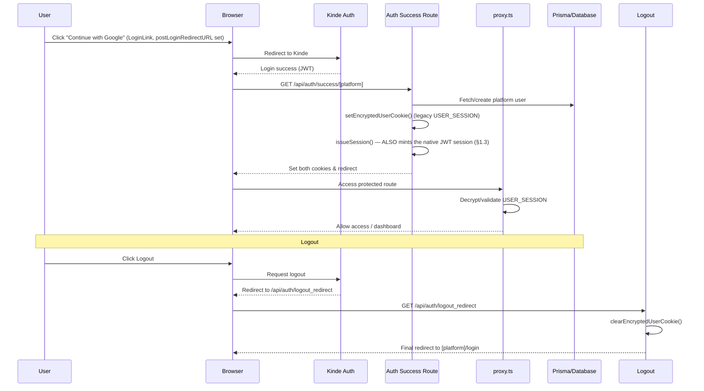

# Authentication & Authorization Technical Guide

This document deep-dives into the technical implementation of authentication and authorization in Twonodes.

> **Two parallel auth systems are live at once.** A native, hand-rolled email+password/JWT system (built during the 2026-08 architecture rebuild, modeled on sibling project proplity's patterns) is the primary path today. Kinde OAuth (Google, etc.) is **not retired** — it still runs as a full, independent auth system for its own login buttons, and a successful Kinde login _also_ mints a native session alongside its own legacy cookie, so downstream code only has to check one thing. See §9 for exactly why both still exist and what depends on each.

---

## 1. Native Email+Password Auth (primary path)

Built in `docs/development-history/phases/phase-1-foundations.md` (Steps 4-6), audited post-rebuild in that same document's "Post-Phase-5 auth audit" section. This is what every registration/login form in the app (`NativeAuthCard`) calls.

### 1.1 Routes — `app/api/v1/auth/*`

| Route                          | Method | Auth                 | Purpose                                                                                                                                                                                                                              |
| ------------------------------ | ------ | -------------------- | ------------------------------------------------------------------------------------------------------------------------------------------------------------------------------------------------------------------------------------ |
| `/api/v1/auth/register`        | POST   | public, CSRF-checked | **Final step of OTP/link-first registration** (see 1.7): takes `{pendingRegistrationId, code, password}`, verifies, and creates the already-verified `{Reva,Surfboard,GBC}User` row. Never accepts an email or role from the client. |
| `/api/v1/auth/login`           | POST   | public, CSRF-checked | `bcrypt.compare` against `passwordHash`; issues a session on success (see 1.3).                                                                                                                                                      |
| `/api/v1/auth/refresh`         | POST   | refresh cookie       | Rotates the refresh token; see 1.4 for the reuse-detection behavior.                                                                                                                                                                 |
| `/api/v1/auth/logout`          | POST   | session              | Revokes the current refresh token, clears cookies.                                                                                                                                                                                   |
| `/api/v1/auth/me`              | GET    | session              | Returns the caller's identity/role for the given platform.                                                                                                                                                                           |
| `/api/v1/auth/change-password` | POST   | session              | Shared across all three products — REVA's settings page, for example, calls this directly rather than having its own password-change function.                                                                                       |

A native-login attempt against an account that has never set a password (Kinde-only account) fails with the same generic "Invalid email or password" a wrong password would — not a different, account-enumerating message.

### 1.2 Where native login is, and isn't, self-service

- **Self-service** (public registration form, `allowRegister` on `NativeAuthCard`): REVA, Surfboard, GBC's regular user-facing login pages.
- **Admin/invite-only** (no registration form — an existing privileged user must create the account first, e.g. via the REVA admin-user-management routes): Surfboard-restricted, Surfboard-MDA, REVA-restricted, GBC-restricted.

### 1.3 Session issuance (`lib/auth/session.ts`)

`issueSession(userId, role, platform, refreshMaxAgeSeconds)` is the one function both native `/login` and every Kinde callback route call (see §9.1) — extracted specifically so both entry points mint an identical session shape.

- **Access token**: `jose` HS256 JWT, **15-minute** lifetime, signed with `JWT_SECRET`.
- **Refresh token**: a random value, **sha256-hashed** before it's stored in the `RefreshToken` table (shared across all three products, not a per-product table) — the plaintext token never touches the database. `rememberMe` at login sets the cookie/token lifetime to **30 days**; unchecked, **1 day**.
- **Cookies**: platform-suffixed, not one fixed pair — `access_token_${platform}`, `refresh_token_${platform}` (`lib/auth/cookies.ts`). This is a deliberate deviation from proplity's fixed-pair cookies: it's what lets a user stay logged into REVA and Surfboard simultaneously in the same browser, matching a capability the legacy `USER_SESSION` cookie's `platforms` map already provided.

### 1.4 Refresh-token rotation & reuse detection (`app/api/v1/auth/refresh/route.ts`)

Every refresh call **rotates** the token: the old one is marked used, a new one is issued in the same `familyId`. If an already-used (or otherwise invalid) refresh token is presented again, the entire `familyId` is revoked — this is the standard defense against a stolen refresh token being replayed after the legitimate user has already rotated past it.

The old token is **claimed and its replacement created in a single transaction**, with `replacedBy` written by the claim itself. The claim is also the concurrency guard: under READ COMMITTED, of two simultaneous refreshes only one matches `revokedAt: null`. (Writing `replacedBy` in a later, separate step left a window where a second tab saw a revoked token with no successor, read it as theft, revoked the whole family and wiped the browser's cookies.)

To prevent multi-tab concurrency races (e.g. multiple tabs waking up simultaneously and sending the same refresh token at once), rotation includes a **30-second concurrency grace window**: if a token was rotated within the last 30 seconds and has an active replacement, the server returns a valid access token for that session rather than misidentifying concurrent tabs as token theft. The grace pass issues an access token only (never a second refresh token) and applies only to a token of the same platform whose successor is still live — a token revoked by logout or a theft response never qualifies. Trade-off: for those 30 seconds a stolen, just-rotated token can still obtain an access token.

On the client, token refreshing is coordinated by `lib/auth/clientRefreshManager.ts`:

- **Single-Flight Deduplication**: Multiple simultaneous 401 responses or tab wakeups share one single-flight refresh Promise instead of firing redundant requests.
- **Dynamic Rescheduling**: Whenever a refresh occurs (via periodic timer, tab focus/wake, or 401 interceptor), the next background timer is shifted to `now + 13m`, avoiding redundant rotations.
- **401 Interceptors**: `surfboard/apiClient.ts`, `reva/apiClient.ts`, and `gbc/apiClient.ts` intercept 401 UNAUTHENTICATED responses, refresh via the manager, and retry the failed request transparently.

### 1.5 CSRF & rate limiting

- **CSRF** (`lib/auth/csrf.ts`): Origin/Referer validation on mutating routes (`login`, `change-password`, etc.) — no separate CSRF token to manage. An unparseable `Origin` (e.g. the literal `null` from a sandboxed iframe) is rejected, not thrown. Note this is a browser cross-site guard only: a non-browser client can set any Origin, so it is never a substitute for authenticating the caller.
- **Rate limiting** (`lib/auth/rateLimit.ts`): DB-backed (`LoginAttempt` table), 5 attempts per 5-minute window per key.
  - `checkRateLimit` + `recordAttempt`: check first, record on failure — used by login, keyed on `ip:email` (email lowercased so varying case can't reset the limit).
  - `consumeRateLimit`: **records first, then counts**, so successes are counted and a burst of parallel requests can't all read the same low count. Used wherever a request costs something or can be guessed at in parallel: `register/send-otp` (buckets `register-send:<ip>` and `register-send-to:<platform>:<email>`), `register/resend-otp` (`register-resend:<ip>`, `register-resend-for:<pendingId>`) and `register` completion (`register-complete:<ip>`).

### 1.6 Registration/login schema

`passwordHash`/`authProviders` (`AuthProvider[]`, values `NATIVE` | `KINDE`) live directly on `RevaUser`/`SurfboardUser`/`GBCUser` — there's no separate identity table. An account's `authProviders` array is additive, so the same account _could_ eventually link both a password and a Kinde identity (the mechanism supports it; nothing in the product currently drives a user through that linking flow).

### 1.7 OTP/link-first registration (`lib/auth/pendingRegistration.ts`)

No user row exists until the emailed secret is confirmed. `POST /register/send-otp` stores the signup in a `PendingRegistration` row (bcrypt-hashed password, `sha256` of the secret, `method` fixed at issue time) and emails either a 6-digit OTP or a link, per the platform's admin-configured `method`. `POST /register` then verifies and creates the account in one step. Properties worth knowing before changing it:

- **The email is fixed server-side at `send-otp`.** The completion request has no `email` field; the account is built from the pending row, so verifying one address can't be attached to another.
- **The password binds the verification to the person who chose it.** Completion requires the password the signup was started with (checked with `bcrypt.compare` after the secret matches). `send-otp` upserts on `(platform, email)`, so someone who resubmits a victim's address with a password they know would otherwise turn the victim's later code-entry into an account the attacker can log into. The OTP flow sends the password the form already holds; the link landing page (`RegisterVerifyLinkCard`) asks for it, because the link is often opened on a different device.
- **The attempt cap is atomic.** An attempt is reserved with a conditional `updateMany` (`attempts < 5`) _before_ the secret is compared, so a burst of parallel guesses is admitted at most 5 at a time. (A read-then-increment cap let all 40 of a 40-way burst through.) A resend issues a new secret and resets the counter.
- **The claim and the account creation are one transaction.** The row's `usedAt: null → now` claim and the user insert commit together: a simultaneous second completion waits on the row lock, then gets the winner's committed account (idempotent) rather than a unique-constraint error, and a failed insert rolls the claim back so the user can retry. The account is created already verified (`emailVerifiedVia` set in the same insert).
- **Emails are stored lowercase and looked up case-insensitively** (`findUserByEmail`: exact match on the unique index first, then `mode: "insensitive"`), so `John@Gmail.com` at login finds the account registered as `john@gmail.com` and can't be registered a second time.

---

## 2. Kinde OAuth (parallel, still live)

Kinde remains the identity provider behind every "Continue with Google" button, and is the **only** mechanism behind a few surfaces that haven't been migrated onto native auth yet (see §9.2).

### 2.1 High-level flow



### 2.2 The 7 callback routes

`app/api/auth/success/{reva,reva-restricted,surfboard,surf-restricted,surf-mda,gbc-restricted,scram}/route.ts` — all 7 live, all 7 now dual-write (§9.1). Two of these paths (`surf-restricted`, `surf-mda`) are **deliberately not renamed** to match the `surfboard-restricted`/`surfboard-mda` route rename that shipped elsewhere: they're redirect URIs registered in Kinde's own dashboard config, external to this codebase — renaming them would break login until someone updates that config by hand. Only their _internal_ destination-redirect strings were updated.

### 2.3 Registration strategy under Kinde

- **Self-service (auto-registration)**: on first successful Kinde login for REVA/Surfboard/GBC's public callbacks, a platform-user record is created automatically with the default `USER` role if none exists.
- **Delegated (admin-registration)**: `surf-mda`/`reva-restricted`/`gbc-restricted` callbacks look for an _existing_ record with an appropriate privileged role; if none is found, the login is rejected to an error page rather than auto-creating an account.

### 2.4 Post-logout redirection (`/api/auth/logout_redirect`)

Reads the user's platform/role from the (about-to-be-cleared) session to send them to the right login page:

- REVA: `/reva-restricted/login` (admin/superadmin) or `/reva/login` (user).
- Surfboard: `/surfboard-restricted/login` (admin/superadmin), `/surfboard-mda/login` (MDA roles), or `/surfboard/login` (user).
- GBC: `/gbc-restricted/login` (admin) or `/gbc/login` (user).
- No session found: falls back to `/`.

Both `/api/auth/logout_redirect` (browser redirect flow) and `/api/v1/auth/logout` (API JSON flow) share `revokeUserSession()` (`lib/auth/session.ts`):

- Revokes active `RefreshToken` entries in Postgres for that user.
- Identifies the user from the access token even if the 15-minute token has expired, via `verifyTokenAllowExpired` (`lib/auth/jwt.ts`): the **signature is verified** (expiry up to the refresh-token lifetime is tolerated) and the token's `platform` must match. An unverified decode would let anyone with a victim's user id forge a cookie and revoke that user's sessions.
- Clears both the native cookies (`access_token_${platform}`, `refresh_token_${platform}`) and the legacy `USER_SESSION` cookie.

---

## 3. The legacy `USER_SESSION` cookie (`utils/encryptedCookies.ts`)

Still the real authorization boundary for `proxy.ts` and roughly 20 downstream consumers (§9.2) — not a harmless leftover.

- **Encryption**: `jose`, `A256GCM` (AES-256-GCM), key from `COOKIE_ENCRYPTION_KEY`.
- **Cookie**: `USER_SESSION`, `httpOnly`, `secure` in production, `sameSite: strict`.
- **Shape** (`EncryptedUserData`): one cookie holds a `platforms: Partial<Record<Platform, PlatformSession>>` map, so a user can be simultaneously logged into REVA, Surfboard, and GBC without one login overwriting another's session — `setEncryptedUserCookie` merges a new platform in rather than replacing the cookie.
- **Refresh**: `proxy.ts` bumps `lastActivity` and re-syncs subscription data into the cookie on active use.

```ts
interface PlatformSession {
  role: RevaRole | SurfboardRole | GBCRole;
  subscription?: {
    status: "active" | "cancelled" | "expired" | "past_due";
    interval: "monthly" | "quarterly" | "annually";
    expiresAt?: number | string | Date | null;
    subCode?: string;
    planCode?: string;
    emailToken?: string;
  };
}

export interface EncryptedUserData {
  platforms: Partial<Record<Platform, PlatformSession>>;
  userId: string;
  email: string;
  firstName: string;
  lastName: string;
  kindeId: string;
  sessionId: string;
  lastActivity: number;
  picture?: string | null;
}
```

## 4. Platform Isolation & Privilege

Being authenticated (by either system) grants nothing on its own. A user must also:

1. **Be registered** — a row in the relevant platform table (`SurfboardUser`, `RevaUser`, `GBCUser`).
2. **Have the required role** for the specific route.

Enforced at the `proxy.ts` layer, which checks both `userData.platform` and `userData.role`. Example: a plain Surfboard `USER` can reach `/surfboard/dashboard` but not `/surfboard-mda/dashboard` or `/surfboard-restricted/dashboard`; an MDA role (Accounts, Charting, ...) can reach the MDA portal but not the regular user dashboard unless separately registered there.

## 5. Authorization & Permissions (`permissions.ts`)

- **REVA**: `USER`, `ADMIN`, `SUPERADMIN` — no MDA-style sub-roles. `canAccessRevaUserPanel` allows all three (admins can reach the regular user panel too); `canAccessRevaAdminPanel` allows `ADMIN`/`SUPERADMIN`; `canAccessRevaSuperAdminPanel` is `SUPERADMIN`-only.
- **Surfboard**: `USER`, `ADMIN`, `SUPERADMIN`, plus 7 MDA sub-roles (`ACCOUNTS`, `CHARTING`, `SURCON`, `RECORDS_I`, `INTAKE`, `RECORDS_II`, `ARCHIVE`) and `MDA_SUPERADMIN` (sees all 7 stages combined; plain platform `SUPERADMIN` also gets unconditional access to every MDA stage, matching the pre-rebuild source's own asymmetry rather than tightening it unasked).
- **GBC**: `USER`, `ADMIN`, `SUPERADMIN`.

Since Phase 2/3, each product also has a **route/nav registry** (`surfboard/access/routes.ts`, `reva/access/routes.ts`) — one array of `{path, label, icon, roles, group}` entries with `canAccessRoute()`/`getNavItemsForRole()` helpers, which `proxy.ts` and the dashboard shells both read from. This replaced hand-written nav arrays that had drifted from what `proxy.ts` actually allowed (a real bug in both products before the registries existed — see the phase-2/phase-3 completion reports in `docs/development-history/phases/`).

```typescript
if (pathname.startsWith("/reva-restricted/dashboard")) {
  hasAccess = canAccessRevaAdminPanel(userData.role);
}
```

## 6. Multi-Platform Simultaneous Login

Both auth systems support staying logged into REVA, Surfboard, and GBC at once in the same browser: the legacy cookie via its `platforms` map, the native system via platform-suffixed cookie names. Logging out of one platform only clears that platform's session/cookies, leaving the others intact.

## 7. Environment Variables

### Kinde

- `KINDE_CLIENT_ID`, `KINDE_CLIENT_SECRET`, `KINDE_ISSUER_URL`, `KINDE_SITE_URL`
- `KINDE_POST_LOGIN_REDIRECT_URL` (typically `/api/auth/success`), `KINDE_POST_LOGOUT_REDIRECT_URL` (must point to `/api/auth/logout_redirect`)

### Native auth

- `JWT_SECRET` — signs the native access tokens. **Required in production** (the app throws at startup if unset there).
- `COOKIE_ENCRYPTION_KEY` — **critical**, 32-byte hex string (64 chars), AES-256-GCM key for the legacy `USER_SESSION` cookie. Rotating it invalidates every active legacy/Kinde-bridged session.

### Base URLs

- `BASE_URL` — internal, server-side redirects.
- `NEXT_PUBLIC_BASE_URL` — public, client-side use.

## 8. Security Best Practices

> [!CAUTION]
> Never commit `.env`. `JWT_SECRET`, `COOKIE_ENCRYPTION_KEY`, and `KINDE_CLIENT_SECRET` are all session-forging-level sensitive.

- Set `NODE_ENV=production` in production so cookies are marked `secure`.
- Rotating `JWT_SECRET` invalidates every native access token immediately (refresh tokens are unaffected — a rotation just forces one refresh cycle). Rotating `COOKIE_ENCRYPTION_KEY` invalidates every legacy/Kinde session.

## 9. Why two systems, and what still depends on Kinde

### 9.1 The dual-write bridge

Rather than cut every Kinde consumer over to the native system in one risky pass, Phase 1 made the 7 Kinde callback routes **additionally** call `issueSession()` (§1.3) alongside their existing `setEncryptedUserCookie()` call. A failure minting the native session is caught and logged, never allowed to break the working Kinde login. This means: log in via Google today, and you get _both_ a legacy `USER_SESSION` cookie and a native JWT session — `GET /api/v1/auth/me` works regardless of which door you came in through.

### 9.2 What still only trusts the legacy cookie

Confirmed by a dedicated post-Phase-5 audit (`docs/development-history/phases/phase-1-foundations.md`, "Post-Phase-5 auth audit" section) — **Kinde is not a harmless leftover**, it's still the real security boundary for:

- `proxy.ts` and its ~20 downstream route-matching consumers.
- `utils/encryptedCookies.ts` itself, plus the per-product `revaAuth.ts`/`surfAuth.ts`/`gbc/utils/auth.ts` helpers.
- `KindeAuthProvider.tsx` (the client-side provider wrapping the app).
- `app/api/v1/reva/session/route.ts`, which self-documents as "not-yet-unified" and reads the legacy cookie directly.

Full retirement of the legacy cookie and `proxy.ts`'s cookie-based gating is a deliberately deferred, dedicated follow-up phase — not scheduled as of this writing.

### 9.3 A known gap: `DashboardShell`'s sidebar nav only sees Kinde-sourced roles

**Found live, 2026-09-04, while verifying an unrelated dark-mode/UI change — not yet fixed.** `components/admin-panel/DashboardShell.tsx` (used by Surfboard-restricted admin and Surfboard-MDA) resolves its sidebar's nav items via `getNavItemsForRole(role, group)`, where `role` comes from the _server-side_ `getEncryptedUserData()` — the legacy, Kinde-only cookie described in §3. Native email/password login (`/api/v1/auth/login`) issues a session via `issueSession()`/`lib/auth/session.ts` and **never sets that cookie**.

Net effect: any admin or MDA staff member who logs in with email+password instead of "Continue with Google" gets an **empty sidebar** — no nav items at all — regardless of their actual role. Reproduced identically for a promoted Surfboard `ADMIN` and a promoted `MDA_SUPERADMIN`, so it isn't MDA-specific; it's the `DashboardShell`/legacy-cookie dependency itself. The rest of the shell (header, content area, the page itself) renders fine — only the registry-driven nav list is affected, because it's the one piece reading `userData?.role` from the cookie rather than the native session.

Not fixed as part of that UI work since it's an auth-architecture question (does `DashboardShell` start reading the native session instead, or does native login also populate the legacy cookie the way Kinde does the reverse?) rather than a styling one. Flagged here for whoever picks up §9.2's eventual cutover.
