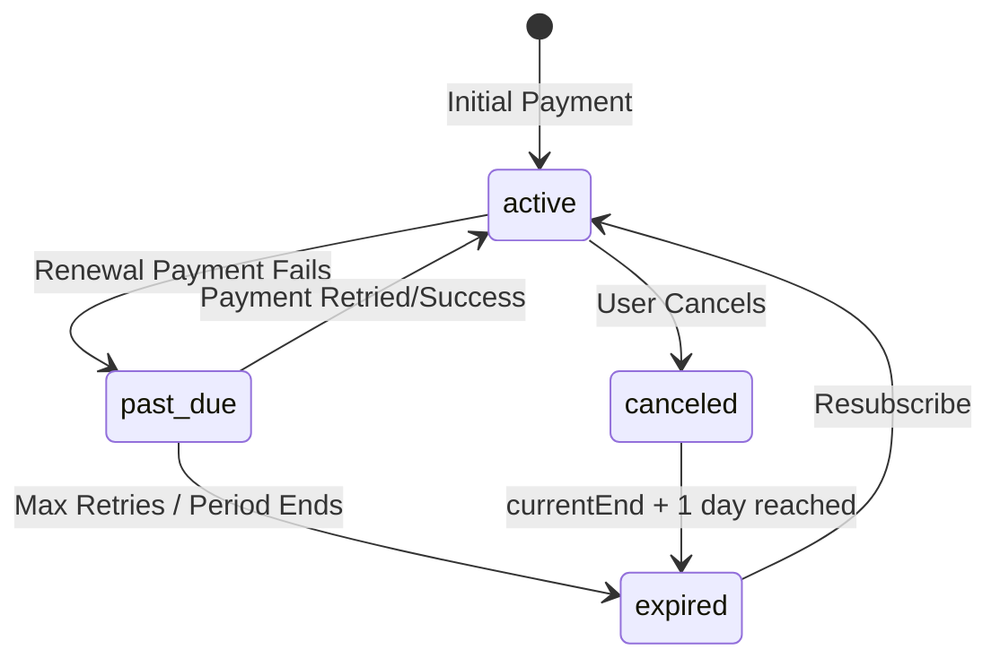

# Surfboard Detailed Subscription Guide

This document provides a deep dive into the Surfboard subscription engine, covering the state machine, database schema, webhook events, and edge-case handling.

## 1. Subscription States & Lifecycle

| State          | Description                                                        | Transition Trigger                                             |
| :------------- | :----------------------------------------------------------------- | :------------------------------------------------------------- |
| **`active`**   | Full access to premium features.                                   | Successful payment (`verifySubscription` or `charge.success`). |
| **`past_due`** | Access continues, but renewal payment failed.                      | `invoice.payment_failed` webhook event.                        |
| **`canceled`** | User turned off auto-renewal. Access continues until `currentEnd`. | `disableSubscription` call or `subscription.disable` webhook.  |
| **`expired`**  | Access revoked. `currentEnd` + 1 day grace period has passed.      | `isSubActiveOrGrace()` check returns `false`.                  |

### Lifecycle Diagram



---

## 2. Technical Component Map

_(Paths current as of the 2026-08 architecture rebuild — see `docs/development-history/phases/phase-2-surfboard.md`. The old `app/(projects)/(surfboard)/actions/{paystackActions,subscriptionActions}.ts` action files this section used to reference are deleted; their logic now lives in `surfboard/services/*` behind `/api/v1/surfboard/*` routes.)_

### A. Initiation & Client Flow

- **`SubscriptionManager.tsx`** (`app/(projects)/(surfboard)/surfboard/dashboard/subscription/SubscriptionManager.tsx`): The primary UI.
  - Handles plan selection and triggers the `PaystackPop` inline checkout.
  - On success, redirects or calls `verifySubscription`.
- **`surfboard/services/paystackSubscriptionService.ts`**: Paystack-facing logic.
  - `initiateSubscription`: Initializes the transaction with `metadata.platform = "surfboard"`.
  - `verifySubscription`: Finalizes the transaction and updates the local DB.
  - `disableSubscription`: Cancels auto-renewal via Paystack.
  - `getOrCreatePaystackPlan`: Resolves/creates the Paystack-side plan record.
- **`app/(projects)/(surfboard)/surfboard/dashboard/subscription/callback/SubCallback.tsx`**: Handles the redirect after external payment (if not using inline).

### B. Background Sync (Webhooks)

- **`app/api/webhooks/paystack/route.ts`**: The core "brain" for async updates — shared across Surfboard/REVA/GBC, kept as one file deliberately rather than split per-product, since its platform-detection logic (§ "Platform Detection Logic" below) needs one place to reconcile ambiguous references. The handler functions below live inline in this file, not in a service:
  - `onSubscriptionCreate`: Upserts the `Subscription` and logs history.
  - `onSubscriptionChargeSuccess`: Handles recurring billing (renewals).
  - `onSubscriptionDisable`: Marks subscription as canceled in DB.
  - `onInvoicePaymentFailed`: Marks subscription as `past_due`.

### C. Domain Logic

- **`surfboard/services/subscriptionService.ts`**: Low-level DB interactions.
  - `createOrUpdateSubscription`: The source of truth for DB state transitions.
  - `getUserActiveSubscription` / `getUserAndActiveSub`: Access-control reads (grace-period logic, see §5).
- **`surfboard/services/subscriptionAnalyticsService.ts`**: Admin-facing subscription analytics/reporting.
- **`app/(projects)/(surfboard)/utils/computePeriod.ts`**: Date calculation engine (not moved into `surfboard/` — a small, dependency-free utility left in place during the Phase 2 folder move).
  - Determines `currentStart` and `currentEnd` based on `monthly`, `quarterly`, or `annually` intervals.

---

## 3. Database Schema Details

### `Subscription` Table

| Field             | Purpose                                                                     |
| :---------------- | :-------------------------------------------------------------------------- |
| `userId`          | Links to `SurfboardUser`.                                                   |
| `subCode`         | The Paystack Subscription ID (e.g., `SUB_xxx`). Required for cancellations. |
| `planCode`        | The Paystack Plan ID (e.g., `PLN_xxx`).                                     |
| `status`          | The current local state (`active`, `canceled`, etc.).                       |
| `currentEnd`      | The end date of the current paid period.                                    |
| `nextPaymentDate` | When Paystack is scheduled to charge next.                                  |

### `SubscriptionHistory` Table

Every significant event is logged here for auditing:

- `subscription.create`
- `subscription.success` (Renewal)
- `subscription.disable` (Cancellation)
- `invoice.payment_failed`

---

## 4. Webhook Payload Examples (Surfboard Specific)

### `subscription.create`

Sent when a new subscription is successfully linked to a customer.

```json
{
  "event": "subscription.create",
  "data": {
    "subscription_code": "SUB_gsjhu22rhpl72mz",
    "status": "active",
    "customer": { "email": "user@example.com", "customer_code": "CUS_xxx" },
    "plan": { "plan_code": "PLN_xxx", "interval": "monthly" },
    "next_payment_date": "2026-03-18T15:13:00.000Z"
  }
}
```

### `charge.success` (Renewal)

Sent every time a recurring payment succeeds.

```json
{
  "event": "charge.success",
  "data": {
    "reference": "SURFBOARD_SUB_live_xxx",
    "amount": 1670000,
    "metadata": { "platform": "surfboard" },
    "subscription": {
      "subscription_code": "SUB_xxx",
      "next_payment_date": "2026-04-18T15:13:00.000Z"
    }
  }
}
```

---

---

## 5. Critical Logic & Business Rules

### The 1-Day Grace Period

`surfboard/services/subscriptionService.ts`'s internal `isSubActiveOrGrace()` (`GRACE_PERIOD_MS = 24 * 60 * 60 * 1000`) allows users to access the platform for **24 hours** after their `currentEnd` date. This prevents immediate lockout due to minor payment delays or time-zone differences. (The pre-rebuild source had a same-purpose `isUserSubscribed()` in `subscriptionActions.ts` — grep-confirmed dead with zero consumers during the Phase 2 migration, so it wasn't carried over; this is the function that actually runs today.)

### Platform Detection Logic (Hardened)

To prevent cross-platform data contamination (e.g., Reva payments showing up in Surfboard history), the system uses a multi-layered detection strategy:

1.  **Top-level Metadata**: Checks `data.metadata.platform`.
2.  **Nested Metadata**: If missing from top-level, it searches `data.metadata.custom_fields` for a "platform" variable.
3.  **Reference Prefixes**:
    - `REVA_` or `reva_` -> Reva
    - `SurfCoD` or `SurfCoDRef_` -> Surfboard CoD
    - `SURFBOARD_SUB_` or `SURF_` -> Surfboard Subscriptions
    - `GBC` or `EB_GBC` -> GBC
4.  **Plan Analysis**: If it's a subscription event without clear metadata, it checks the `planCode` against a whitelist of known Surfboard plans.

### Quarterly Interval (Fixed)

The `computePeriodPerTimestamp` function previously used 4 months for quarterly intervals. This has been corrected to **3 months** to match standard quarterly billing cycles (Jan, Apr, Jul, Oct).

### Idempotency

We use the `WebhookEvent` table to log every incoming Paystack signature. If the same signature is sent twice, the system skips processing the second time (`ledgerId === null`).

---

## 6. Troubleshooting & Common Issues

- **"Subscription sync pending"**: Occurs when a user tries to cancel but the system hasn't yet received the `subCode` from Paystack via webhook.
- **Wrong Platform History**: Resolved by strict `detectPlatform` logic in `route.ts`. Users should no longer see Reva or GBC history in their Surfboard dashboard.
- **Plan Mismatch**: If `isSurfboardPlan()` fails, renewals are skipped. Ensure all new Paystack plans are added to the `.env` file (`SURF_MONTHLY`, etc.).
