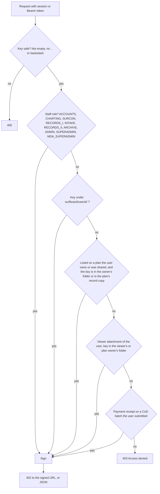

# Case Study: Private Files on AWS S3 in the TwoNode Platform

How Surfboard, REVA and GBC store and serve files on Amazon S3 today, checked against the code on **2026-11-03** (branch `dev`, commit 97532ea1).

This is a description of one real system, not a template. The reusable rules are in [`s3-private-files-blueprint.md`](./s3-private-files-blueprint.md); section 8 below compares this system with them, including where it falls short. Links point into the TwoNode repository and only open inside it.

Decision records: [ADR-0012](../adr/0012-multi-provider-storage-and-surveyor-file-privacy.md) (storage layer and surveyor privacy), [ADR-0013](../adr/0013-bucket-key-layout-public-and-private-prefixes.md) (private by default, `public/` for public files), [TASK-0011](../tasks/0011-s3-privacy-and-key-layout.md) (the clean-up). Open findings: I-020 to I-023 and I-051 in [`docs/issues/index.md`](../issues/index.md).

---

## 1. The bucket

One S3 bucket (`reva-store` in `eu-north-1` per the hand-off; the code reads `AWS_BUCKET_NAME`) serves all three apps: Surfboard plans and drawings, REVA client documents, GBC website images and ticket QR codes.

| Setting             | State                                                                                                                                              | Source                 |
| :------------------ | :------------------------------------------------------------------------------------------------------------------------------------------------- | :--------------------- |
| Object ACLs         | Disabled (`BucketOwnerEnforced`). The bucket policy is the only thing that can make an object public                                               | TASK-0011              |
| Block Public Access | **Off, on purpose.** GBC website images are served by plain S3 URL, so the bucket policy must be able to allow anonymous reads                     | ADR-0013, TASK-0010    |
| Bucket policy       | **Private by default.** Anonymous read only on an explicit allow-list: `public/gbc/*` and the `GBC2/` image folders (per policy v4, section below) | ADR-0013, hand-off 4.1 |
| Encryption          | S3 default (SSE-S3)                                                                                                                                | AWS default            |

This is **not** the "all four Block Public Access settings on" model of the generic blueprint. TwoNode accepts that trade-off because its website images are public. The protection is the allow-list in the bucket policy plus the signed-link gateway, not the account-level blocks.

**Policy status needs checking.** The docs disagree about which bucket policy is live. [HANDOFF-FOR-NEXT-AI.md section 4.1](../../HANDOFF-FOR-NEXT-AI.md) says **policy v4 is live** (anonymous read only on `GBC2/gallery/*`, `GBC2/speakers/*`, `GBC2/logos/*` and `public/gbc/*`; the bucket is `reva-store` in `eu-north-1`). The tasks list says v4 is "drafted", [TASK-0011 line 75](../tasks/0011-s3-privacy-and-key-layout.md) says v2 was applied on 2026-10-16, TASK-0011's last section still lists "paste `out/aws/bucket-policy-v2.json`" as open, ADR-0013's header says v1, and the issues register still shows I-020 and I-021 as Open. `out/aws/` holds only DRAFT files for v3 and v4. Most likely v4 supersedes the rest and the old lines are stale, but only the live policy can say. This is tracked as a follow-up in TASK-0011. Read the live state:

```bash
aws s3api get-bucket-policy --bucket "$AWS_BUCKET_NAME" --query Policy --output text | jq .
aws s3api get-bucket-policy-status --bucket "$AWS_BUCKET_NAME"
aws s3api get-public-access-block --bucket "$AWS_BUCKET_NAME"
curl -s -o /dev/null -w '%{http_code}\n' "https://$AWS_BUCKET_NAME.s3.$AWS_REGION.amazonaws.com/<a key under reva/uploads/ or uploads/>"   # expect 403
```

---

## 2. Code map

| Piece             | File                                                                                                                                                                                                                                                           | What it does                                                                                                                                                                                                                                                                                                                 |
| :---------------- | :------------------------------------------------------------------------------------------------------------------------------------------------------------------------------------------------------------------------------------------------------------- | :--------------------------------------------------------------------------------------------------------------------------------------------------------------------------------------------------------------------------------------------------------------------------------------------------------------------------- |
| Provider layer    | [`lib/storage/`](../../lib/storage/) (`index.ts`, `types.ts`, `utils.ts`, `providers/`)                                                                                                                                                                        | A `StorageAdapter` interface (`upload`, `getPresignedUploadUrl`, `getDownloadUrl`, `delete`, `deleteMultiple`). `STORAGE_PROVIDER` / `SURFBOARD_STORAGE_PROVIDER` picks one; the default is `s3`. Other adapters exist (R2, MinIO, Supabase, Cloudinary, ImageKit, Vercel Blob, local disk); **S3 is the one in production** |
| S3 adapter        | [`lib/storage/providers/s3.ts`](../../lib/storage/providers/s3.ts)                                                                                                                                                                                             | `S3Client` with static IAM-user keys from `AWS_ACCESS_KEY_ID` / `AWS_SECRET_ACCESS_KEY`, `forcePathStyle: true`, endpoint `https://s3.<region>.amazonaws.com`. `PutObject`, presigned PUT and GET, `DeleteObject(s)`                                                                                                         |
| Key builders      | [`lib/storage/utils.ts`](../../lib/storage/utils.ts)                                                                                                                                                                                                           | `buildStorageKey`, `buildPlanFileKey`, `putUnderFreeName`, `attachmentDisposition`, `extractKeyFromUrl`                                                                                                                                                                                                                      |
| Surfboard service | [`surfboard/services/awsService.ts`](../../surfboard/services/awsService.ts)                                                                                                                                                                                   | Thin wrappers: `uploadSurfboardFileToS3`, `getPresignedUploadUrl`, `getPresignedDownloadUrl`, delete helpers                                                                                                                                                                                                                 |
| Access rules      | [`surfboard/utils/fileAccess.ts`](../../surfboard/utils/fileAccess.ts)                                                                                                                                                                                         | `clampExpiresIn`, `isSafeStorageKey`, `keyBelongsToAllowedUser`, `isRedCopyKeyOfPlan`                                                                                                                                                                                                                                        |
| Surfboard gateway | [`app/api/v1/surfboard/files/view/route.ts`](../../app/api/v1/surfboard/files/view/route.ts)                                                                                                                                                                   | Checks the caller, then signs and redirects (or returns JSON)                                                                                                                                                                                                                                                                |
| Mobile link       | [`surfboard/services/planFileLinkService.ts`](../../surfboard/services/planFileLinkService.ts)                                                                                                                                                                 | `GET plans/{planId}/files/{position}` returns a 300 s link                                                                                                                                                                                                                                                                   |
| REVA              | [`app/(projects)/(reva)/reva/actions/awsActions.ts`](<../../app/(projects)/(reva)/reva/actions/awsActions.ts>), [`reva/utils/uploadKey.ts`](../../reva/utils/uploadKey.ts), [`reva/services/downloadOtpService.ts`](../../reva/services/downloadOtpService.ts) | **Its own S3 client.** Private keys, OTP-gated downloads                                                                                                                                                                                                                                                                     |
| GBC               | [`gbc/utils/aws-s3.ts`](../../gbc/utils/aws-s3.ts), [`gbc/utils/storageKeys.ts`](../../gbc/utils/storageKeys.ts)                                                                                                                                               | **Its own S3 client.** Public images, private QR codes, signed links                                                                                                                                                                                                                                                         |
| Config            | [`.env.example`](../../.env.example) lines 38–49                                                                                                                                                                                                               | `STORAGE_PROVIDER`, `AWS_REGION`, `AWS_BUCKET_NAME`, `AWS_ACCESS_KEY_ID`, `AWS_SECRET_ACCESS_KEY`                                                                                                                                                                                                                            |

There are **three** S3 clients (the adapter, REVA and GBC), all built from the same environment variables. A credential or setting change has to be checked in all three.

---

## 3. Key layouts

| App                                                           | Layout                                                                                  | Notes                                                                                                                                                                                                                           |
| :------------------------------------------------------------ | :-------------------------------------------------------------------------------------- | :------------------------------------------------------------------------------------------------------------------------------------------------------------------------------------------------------------------------------ |
| Surfboard plan files (`pdf`, `cad`, `certificate`, `redcopy`) | `surfboard/{userId}/{type}/{PLAN_NUMBER}[_2].{ext}`                                     | `buildPlanFileKey`. The plan number is the canonical form with `/` written as `_`. A second file for the same plan becomes `_2`, `_3` … via `putUnderFreeName` and `IfNoneMatch: "*"` (handles `412` and `409`, up to 50 tries) |
| Surfboard other files (`viewer-attachment`, `general`)        | `surfboard/{userId}/{type}/{planKey or timestamp}__{random or timestamp}__{clean-name}` | `buildStorageKey`. The name is normalised (accents stripped, only `a-z 0-9 . _ -`, spaces to `-`, lower case)                                                                                                                   |
| Surfboard record copies (red copy)                            | `surfboard/{plan number}/redcopy/{file}`                                                | The **plan number** takes the place of the user id. ADR-0012 says the user id; I-023 records the gap                                                                                                                            |
| REVA, new                                                     | `private/reva/{folder}/{suffix}-{safe-name}`                                            | `revaUploadKey`. `folder` comes from the REVA `reference`                                                                                                                                                                       |
| REVA, legacy                                                  | `reva/uploads/{reference}-{timestamp}-{name}`                                           | Flat, owner not in the key                                                                                                                                                                                                      |
| GBC public images                                             | `public/gbc/{edition}/{folder}/{file}`                                                  | `gbcPublicKey`                                                                                                                                                                                                                  |
| GBC QR codes                                                  | `private/gbc/{edition}/qrcodes/{file}`                                                  | `gbcQrCodeKey`                                                                                                                                                                                                                  |
| GBC legacy                                                    | `GBC2/…`                                                                                | Hard-coded for every GBC upload before editions (I-022)                                                                                                                                                                         |

The database stores **full object URLs** (`https://<bucket>.s3.<region>.amazonaws.com/<key>`) for most records, not keys. Moving a file therefore means rewriting rows, which is why ADR-0013 does not move old objects by default. `extractKeyFromUrl` turns a stored URL back into a key.

---

## 4. Uploads

### Server-mediated (most files)

Three Surfboard routes accept `multipart/form-data`, each behind `withAuth` and a CSRF check:

| Route                    | Key owner segment comes from                                                                                                                 |
| :----------------------- | :------------------------------------------------------------------------------------------------------------------------------------------- |
| `files/upload`           | A `userId` **form field**. The route comment says every real caller sends the plan number there, so the segment is whatever the caller sends |
| `files/upload-with-auth` | The session user id                                                                                                                          |
| `files/upload-multi`     | The session user id; names each file after the plan number                                                                                   |

Next.js turns the file into a `Buffer` and calls `PutObject` with metadata (`originalName`, `fileType`, `planNumber`, `uploadedAt`). **No size or type check** exists in these routes or in the S3 adapter. Vercel limits a Route Handler request body to about 4.5 MB (noted in [`planViewerAttachmentService.ts`](../../surfboard/services/planViewerAttachmentService.ts)), which has already broken real uploads and is why the next path exists.

### Direct to S3 (viewer attachments only)

`getViewerAttachmentUploadUrl` calls the adapter's `getPresignedUploadUrl`: a presigned **PUT** valid for 300 s, key built on the server as `surfboard/{viewerId}/viewer-attachment/{planId}__…`. The browser PUTs the file straight to S3 and then calls `finalizeViewerAttachment`, which checks the caller is a recipient of the plan **and that the key starts with `surfboard/{viewerId}/viewer-attachment/{planId}__`** before it saves the record. That prefix check is the right idea (a client cannot register a key it was not issued). It does not yet `HeadObject` the key or limit size and type. Large CAD files do **not** use this path; they go through the server routes above.

**Checksum parameters in the signed PUT.** The adapter's S3 client sets no checksum option. With the installed SDK (`@aws-sdk/client-s3` 3.985.0), a presigned PUT it creates carries `x-amz-checksum-crc32=AAAAAA==` (the CRC32 of an empty body) and `x-amz-sdk-checksum-algorithm=CRC32`, measured offline with dummy credentials. Passing `requestChecksumCalculation: "WHEN_REQUIRED"` removes them. Whether S3 accepts an upload against that URL was not tested (it needs real credentials): try a viewer-attachment upload on staging.

### REVA and GBC

REVA uploads run on the server (`uploadToS3FromServer`) into `private/reva/…`. GBC uploads run on the server (`uploadToS3`) into `public/gbc/…` or `private/gbc/…/qrcodes/`.

---

## 5. Viewing and downloading

### Surfboard gateway: `GET /api/v1/surfboard/files/view`

| Parameter           | Meaning                                                                 |
| :------------------ | :---------------------------------------------------------------------- |
| `url` or `key`      | The file. A full stored URL is accepted and converted to a key          |
| `format=json`       | Return `{ success: true, url }` (no `expiresAt`). Default is a redirect |
| `download=1&name=…` | Sets `Content-Disposition: attachment`                                  |
| `expiresIn`         | Seconds, **clamped to 30–900**, default 300                             |



Details that matter:

- **Staff skip every ownership check.** Ten roles may sign any key they ask for.
- **The record copy belongs to the owner alone.** A plan shared with someone opens its PDFs, drawings and certificates but not its record copy (I-037).
- **Denied is `403`**, not `404`. The blueprint recommends `404`.
- The redirect carries `Cache-Control: private, max-age=min(240, expiresIn − 60)` and `Vary: Cookie`, so a refresh does not re-download.

### Mobile: `GET plans/{planId}/files/{position}`

`getPlanFileLink` returns `{ url, expiresAt, name, format }` with a fixed 300 s link. It refuses (`404`) unless the key is in the plan owner's folder or is the plan's record copy. This is the shape the blueprint recommends: it takes a plan and a position, not a key.

### Backend-internal

`verificationService` signs a 300 s URL for a plan's record copy, fetches the bytes server-side (up to three tries) and base64-encodes them for the verification service.

### REVA: one-time code first

`requestDownloadOtp` emails a code (valid 10 minutes). `verifyDownloadOtpAndGetUrl` finds the latest unused, unexpired code for that reference and target, counts wrong attempts against `MAX_ATTEMPTS`, compares a **hash** of the code, marks it used, and only then returns a 300 s presigned URL. Signed-link gateways (`/api/v1/reva/files/view`) cover the REVA pages themselves.

### GBC

`getSignedS3Url(key, expiresIn = 3600)` signs links to private GBC files, such as ticket QR codes, for **one hour** by default, not five minutes. Public images use plain URLs under `public/gbc/…`.

---

## 6. Deleting

| Path                        | Check                                              | Order                                                                                                                                                                                                      |
| :-------------------------- | :------------------------------------------------- | :--------------------------------------------------------------------------------------------------------------------------------------------------------------------------------------------------------- |
| Delete a plan               | Owner, or an admin                                 | Storage first (`DeleteObjects` on the plan's PDF, drawing and certificate URLs; the record copy is not in that list), **then** the database. A storage failure stops the delete and leaves the plan intact |
| Remove one file from a plan | Plan looked up by `{ id, userId }`                 | Storage first, then the database                                                                                                                                                                           |
| Delete a viewer attachment  | `viewerId` must match                              | Database row only. **The S3 object stays**                                                                                                                                                                 |
| `POST files/delete`         | **None.** Passes any `key` or `url` to the adapter | Storage only. This is I-051 (P1)                                                                                                                                                                           |

---

## 7. What a signed URL looks like here

The adapter uses `forcePathStyle: true` with a regional endpoint, so URLs it signs are path-style:

```text
https://s3.eu-north-1.amazonaws.com/<bucket>/surfboard/<userId>/pdf/<PLAN_NUMBER>.pdf
  ?X-Amz-Algorithm=AWS4-HMAC-SHA256
  &X-Amz-Credential=<access key id>%2F20261103%2Feu-north-1%2Fs3%2Faws4_request
  &X-Amz-Date=20261103T145654Z
  &X-Amz-Expires=300
  &X-Amz-SignedHeaders=host
  &X-Amz-Signature=<64 hex>
  &response-content-disposition=attachment%3B%20filename%3D%22…%22%3B%20filename*%3DUTF-8%27%27…
```

The download name goes through `attachmentDisposition`, which strips control characters, quotes and slashes and adds a UTF-8 `filename*`. Stored URLs (in the database) are the virtual-hosted form instead, which is what `extractKeyFromUrl` expects.

---

## 8. How this compares with the blueprint

| Blueprint rule                                            | TwoNode today                                                                                                                                                                                                                                                                               | Open item                                                                                                                                  |
| :-------------------------------------------------------- | :------------------------------------------------------------------------------------------------------------------------------------------------------------------------------------------------------------------------------------------------------------------------------------------ | :----------------------------------------------------------------------------------------------------------------------------------------- |
| 1. Bucket private, all four blocks on                     | Private by allow-list; Block Public Access **off by design** because of public GBC images                                                                                                                                                                                                   | Decision recorded in ADR-0013. Check the live policy (section 1)                                                                           |
| 2. Server builds every key; clients never send one        | Uploads: server-built, except `files/upload` takes its owner segment from the form. Reads and deletes: `files/view` and `files/delete` accept a `key` or `url`                                                                                                                              | I-051 (delete). Consider moving the web to a file-id contract like the mobile link                                                         |
| 3. Check by file id, `404` for both missing and not yours | `files/view` checks by key and answers `403`. Staff bypass is broad                                                                                                                                                                                                                         | Design choice; revisit with I-051                                                                                                          |
| 4. Short links                                            | 300 s default, 30–900 s clamp on `files/view`; mobile and REVA 300 s; **GBC 3600 s**                                                                                                                                                                                                        | GBC may be intentional; confirm                                                                                                            |
| 5. S3 enforces size and type                              | Server routes: none; Vercel caps bodies at ~4.5 MB. Viewer attachments use presigned PUT with no size limit, and the JS presigner leaves `content-type` out of a PUT's signature unless told otherwise (checked offline). The signed PUT also carries CRC32 checksum parameters (section 4) | Move viewer attachments to presigned POST with `content-length-range`; add `HeadObject` to finalize; until then test the upload on staging |
| 6. File name in the database, not the key                 | Plan files are named by plan number (good); other files carry a cleaned name in the key                                                                                                                                                                                                     | Fine as is                                                                                                                                 |
| 7. Delete uses the same check as read                     | Plan delete: yes. Viewer attachment delete: yes. `files/delete`: no                                                                                                                                                                                                                         | I-051                                                                                                                                      |
| 8. Sweep what was never finished                          | **No sweeper.** Cron jobs are `subscription-expiry-reminders` and `push-receipts` only. Deleted viewer attachments leave objects behind                                                                                                                                                     | New item: a storage clean-up job                                                                                                           |
| Private URLs are never stored                             | Plan and record-copy fields store full object URLs (not signed URLs); signed links are made per request                                                                                                                                                                                     | Good. Storing keys instead of URLs would make a provider move cheaper                                                                      |

Other known gaps:

- I-022: `GBC2/` hard-coded for GBC uploads.
- I-023: record copies under the plan number, not the user id.
- Three S3 clients to keep in step (section 2).
- Policy status (section 1): tracker and issues register disagree; resolve against the live bucket.

---

## 9. Run the checks against TwoNode

The blueprint's section 11 and the hybrid blueprint's section 8 describe checks that work on any bucket. The TwoNode ones that matter most:

| Check                                                                     | Expect                                                                                                            |
| :------------------------------------------------------------------------ | :---------------------------------------------------------------------------------------------------------------- |
| `get-bucket-policy-status`                                                | `IsPublic: true` (public GBC images). That is expected here; what matters is **which prefixes** the policy allows |
| Anonymous `GET` on a `surfboard/…` object                                 | `403`                                                                                                             |
| Anonymous `GET` on `reva/uploads/…` and `uploads/…`                       | `403` (TASK-0011 says verified 2026-10-16)                                                                        |
| Anonymous `GET` on an object at the bucket root, for example `test/x.txt` | `403`                                                                                                             |
| Anonymous `GET` on `public/gbc/…`                                         | `200`                                                                                                             |
| `files/view` as a surveyor for another surveyor's key                     | `403`                                                                                                             |
| `files/view` as a surveyor for a plan shared with them, record copy key   | `403`                                                                                                             |
| `plans/{id}/files/{n}` JSON as the owner, then fetch `url` after 305 s    | `200`, then `403`                                                                                                 |
