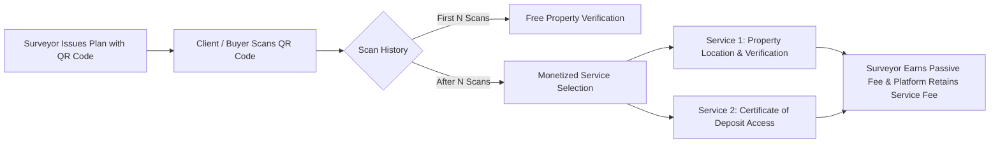

# Surfboard QR Code Earnings & Certificate of Deposit (CoD)

## Executive Product Brief & Implementation Plan (Non-Technical Stakeholders)

> **Status**: QR Code Earnings shipped — Phase 1 of the 2026-08 architecture rebuild migrated it to `surfboard/services/qrEarningsService.ts` behind `/api/v1/surfboard/{qr,admin}/*` (11 routes, confirmed 2026-09-14: 3 public paywall/payment routes — `qr/access-state`, `qr/payments`, `qr/payments/verify` — and 8 authenticated earnings/withdrawal/KYC/admin routes — `qr/bank-details`, `qr/earnings-overview`, `qr/settings`, `qr/withdrawals`, `admin/qr/settings`, `admin/qr/stats`, `admin/qr/withdrawals`, `admin/qr/withdrawals/[id]`). All 5 roadmap phases below describe what was originally planned; the feature is live, not a future plan. See `docs/development-history/phases/phase-1-foundations.md` (Step 9) for what actually shipped, including a real payment-bypass vulnerability that was found and fixed during the migration.

---

## 1. Executive Summary & Vision

As part of the **"TwoNode at 2"** milestone campaign, Surfboard is taking its first major step toward unlocking the long-term economic value of survey plans.

Currently, the QR Code printed on survey plan documents serves solely to verify plan details. Through **QR Code Earnings**, we are transforming every physical and digital survey plan into an ongoing revenue-generating asset for surveyors, while providing high-value property location and official documentation services to land clients, buyers, and legal agents.

---

## 2. Core Value Proposition & Key Features

### A. Flexible Free Tier Threshold

- **Client Consideration**: Surveyors noted that clients who just paid substantial fees for survey work should not be charged immediately on their first scan.
- **Solution**: Admins can set a configurable number of **Free Scans** (e.g., first 5 uses are completely free). Payment is only required from the 6th scan onward.

### B. Dual QR Code Services

1. **Service 1 — Know Actual Location & Authenticity**:
   - Allows clients, agents, and buyers to verify that the survey plan matches the property's physical location.
   - Provides interactive maps, exact coordinates, and turn-by-turn driving directions to the property.
2. **Service 2 — Access Certificate of Deposit (CoD)**:
   - Allows clients to view and download the official Certificate of Deposit issued by the Office of the State Surveyor General (OSSG).
   - Crucial for land title applications (Certificate of Occupancy, Governor's Consent, mortgages).
   - If the certificate is still being processed by government officials, displays a real-time status update.

### C. Temporary 1-Hour Access Protection

- To prevent single buyers from purchasing access once and circulating static links indefinitely, paid access remains active for **exactly 1 hour**.
- Within the 1-hour window, users can freely refresh or revisit the link.
- After 1 hour, access expires with a friendly prompt: _"Your access has expired. Please purchase access again to continue."_

---

## 3. Stakeholder Experience & Workflows

### 👨‍💼 For Surveyors (The Earnings Portal)

- **New QR Earnings Page**:
  - Real-time display of **Available Balance**, **Total Earned**, **Pending Withdrawals**, and **Total Withdrawn**.
  - Itemized transaction ledger showing which survey plan generated income and which service was purchased.
- **Bank Account Setup & Verification (KYC)**:
  - Surveyors add their bank details under Settings.
  - Once verified by admins, surveyors can request direct withdrawals of accumulated earnings to their bank account.
- **Instant Notifications**:
  - In-app badge and email alert whenever a survey plan generates earnings or a withdrawal is processed.

### 🛡️ For Platform Admins & Operations

- **QR Earnings Revenue Dashboard**:
  - Comprehensive breakdown of total platform revenue split between Verification Fees and Service Fees.
  - Leaderboard ranking top-earning surveyors and highest-performing survey plans.
  - Visual charts showing revenue trends and popular services.
- **Withdrawal Queue Management**:
  - Central queue to review, approve, and record bank payouts to surveyors.
- **Dynamic Pricing Controls**:
  - Admins can update Verification Fees, Service Fee percentages, free scan thresholds, or introduce custom fees (e.g. MDA fees) instantly from Admin Settings without code deployments.

---

## 4. Implementation Roadmap & Timeline

| Phase       | Milestone                         | Key Deliverables                                                                     | Stakeholder Impact                                      |
| :---------- | :-------------------------------- | :----------------------------------------------------------------------------------- | :------------------------------------------------------ |
| **Phase 1** | **Database & Pricing Engine**     | Configurable fee settings, scan tracking, user wallet data models.                   | Internal readiness for feature launch.                  |
| **Phase 2** | **Public Paywall & Timed Access** | Dual-service selection modal on QR scan page, 1-hour session timer, payment gateway. | Smooth purchasing experience for end-clients.           |
| **Phase 3** | **Surveyor Earnings & Bank KYC**  | Surveyor "QR Earnings" page, bank account entry, withdrawal request flow.            | Surveyors begin tracking and claiming passive revenue.  |
| **Phase 4** | **Admin Dashboard & Analytics**   | Revenue analytics, surveyor leaderboard, payout processing queue.                    | Full administrative control and financial transparency. |
| **Phase 5** | **Testing & Official Launch**     | End-to-end verification, notification delivery, user acceptance testing.             | Official rollout under "TwoNode at 2" campaign.         |

---

## 5. Summary of Key Business Rules

1. **Free Scans**: Editable in Admin Settings (default: 5 free scans per survey plan).
2. **Pricing Structure**: Total Client Price = Verification Fee + Service Fee (% of Verification Fee) + Custom Fees.
3. **Surveyor Payout Eligibility**: Surveyors accumulate earnings automatically, but can only request withdrawals after completing Bank Account KYC verification.
4. **Access Lifetime**: 1 hour from payment confirmation.
